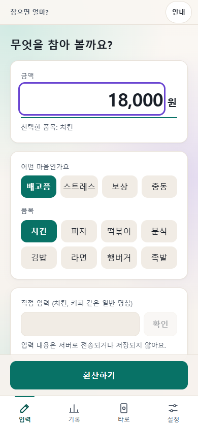
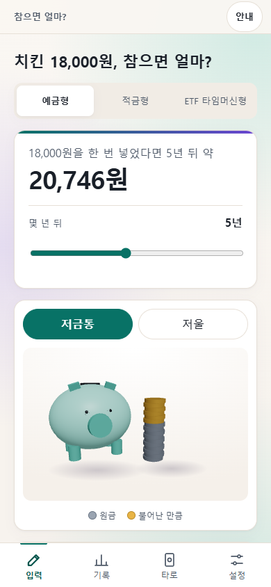
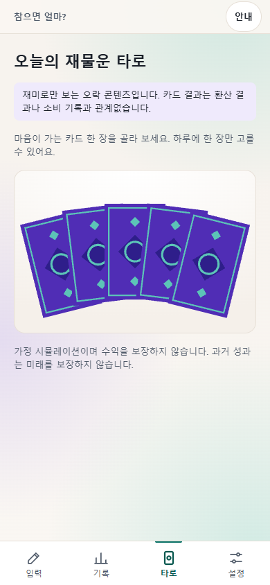
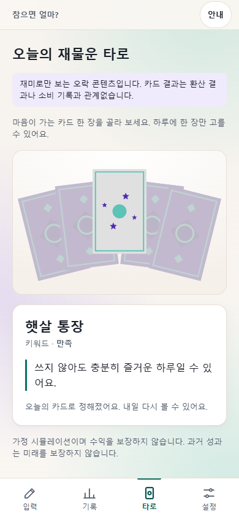
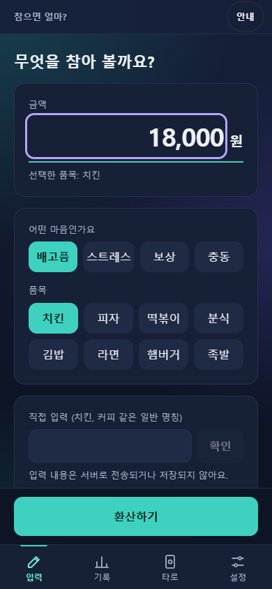
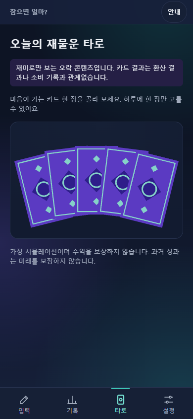
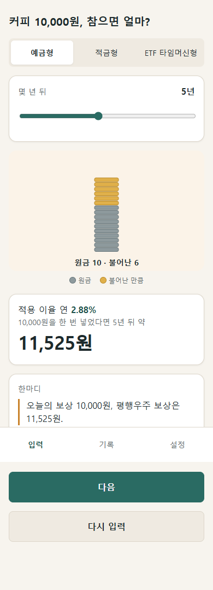
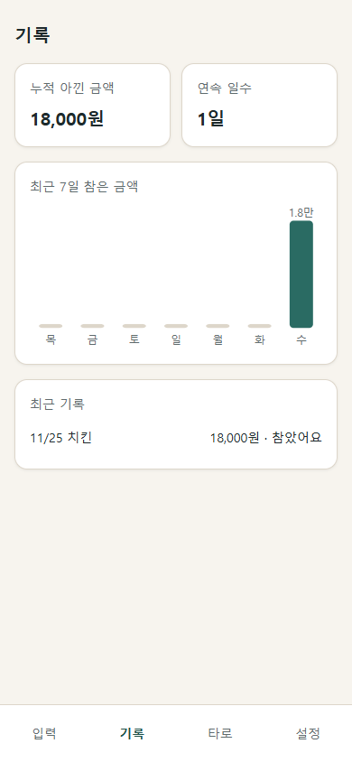

# 참으면 얼마?

사려던 금액을 가정 이율과 과거 지수 상승률로 환산해 3D 저금통과 저울로 보여 주는 충동 소비 억제 웹앱이다. 서버 없이 정적 파일만으로 동작한다.

> 가정 시뮬레이션이며 수익을 보장하지 않습니다. 과거 성과는 미래를 보장하지 않습니다.

## 요약

[](https://github.com/Woogie-Gim/chameumyeon-eolma/actions/workflows/ci.yml)

- 금액과 품목을 넣으면 가정 이율과 ETF 유형 과거 상승률로 환산해 3D 저금통과 저울로 보여 주는 정적 웹앱
- 서버, 런타임 LLM, 외부 API 호출 없음. 문구는 사전 작성한 JSON에서 고르고 기록은 기기 localStorage에만 저장

빠른 실행:

```bash
npm ci
npm run dev
npm test
```

앱인토스 제출 현황:

- 카테고리: 비게임, 금융 > 소비 > 가계부/절약
- 심사 요청: 2026-11-25
- 승인: 2026-11-25
- 출시: 2026-11-25
- 번들 방식: 웹 번들(.ait)

검증 요약:

| 항목 | 결과 |
| --- | --- |
| 단위 테스트 (`npm test`) | 28개 파일, 363개 통과 |
| E2E (`npm run test:e2e`) | 11개 파일, 54개 중 52개 통과, 2개 건너뜀(스크린샷 생성용, `SCREENSHOTS=1`일 때만 실행) |
| 금칙어 스캔 (`npm run scan:banned`) | 검사 파일 61개, 위반 0건 |
| 린트 (`npm run lint`) | 경고 0건, 오류 0건 |
| Lighthouse 13.6.0 (모바일, 첫 화면, 2026-11-25 측정) | 성능 100, 접근성 100, 권장사항 100 |
| 번들 크기 (`npm run build`) | 메인 JS 338.51 kB(gzip 100.01 kB), CSS 20.58 kB(gzip 4.80 kB), three 청크 918.31 kB(gzip 242.57 kB, 3D 화면에서만 로드), `.ait` 약 423 kB(압축 메타데이터로 빌드마다 몇 바이트 달라짐) |

수치 측정일: 2026-11-26(Lighthouse 제외). 상세 내용은 아래 [품질 보증](#품질-보증)에 있다.

## 실행 화면

| 입력(라이트) | 결과(라이트) | 타로 고르기 전(라이트) | 타로 고른 뒤(라이트) |
| --- | --- | --- | --- |
|  |  |  |  |

| 입력(다크) | 결과(다크) | 타로 고르기 전(다크) | 타로 고른 뒤(다크) |
| --- | --- | --- | --- |
|  |  |  |  |

| 결과(3D 저금통) | 결과(3D 저울) | 결과(2D 폴백) | 기록 | 이용 안내 |
| --- | --- | --- | --- | --- |
|  |  |  |  |  |

스크린샷은 E2E 테스트가 모바일 뷰포트(390×844) 한 화면 크기로 저장한 것이다. 각 화면의 맨 위에서 캡처하므로 아래쪽 내용은 잘릴 수 있다. 라이트와 다크는 `screenshots.spec.ts`가 테마마다 새 브라우저 컨텍스트로 찍는다.

## 주요 기능

- **입력**: 카테고리(배고픔, 스트레스, 보상, 충동)와 품목 칩을 고르거나 일반 명칭을 직접 입력하고 금액을 넣는다. 상호명이나 상품명으로 의심되는 입력은 거부한다.
- **환산** (3가지 방식)
  - 예금형: 일시 예치, 연 복리
  - 적금형: 매달 같은 금액을 넣는 월 복리
  - ETF 타임머신형: N년 전 초에 넣었다면 기준 연도 말에 얼마인지 계산한다. 기술주 ETF형과 대형주 ETF형의 과거 연간 상승률을 쓴다.
- **3D 저금통**: 원금 대비 배율만큼 코인을 쌓는다. 원금 코인과 불어난 코인은 색으로 구분한다. 금액은 카운트업으로 보여 주고, 코인이 다 쌓이면 맨 위 코인이 잠깐 반짝인다. WebGL 미지원, 동작 줄이기 설정, 저사양 3D 끄기 설정에서는 같은 정보를 2D 그래픽으로 보여 준다.
- **3D 저울**: 결과 화면에서 저금통과 저울을 바꿔 볼 수 있다(기본은 저금통). 한쪽 접시에는 지금 쓰는 금액 더미, 다른 쪽에는 환산 금액 코인 더미를 올리고 두 금액의 비율만큼 기울인다. ETF형이 하락한 구간에서는 쓰는 금액 쪽으로 기운다. 2D 폴백은 막대 두 개 비교다.
- **한마디**: 미리 작성해 둔 문구 사전에서 카테고리, 금액 구간, 톤에 맞는 문구를 하나 고른다.
- **선택과 기록**: 참았어요 또는 샀어요/먹었어요를 기록한다. 누적 참은 금액, 연속 일수, 최근 7일 그래프를 보여 준다.
- **재물운 타로**: 화면에 들어오면 22장 중 5장을 무작위로 골라 순서를 섞어 뒷면으로 펼친다. 한 장을 탭하면 효과음과 함께 그 카드가 뒤집히고 나머지는 흐려진다. 카드 이름, 키워드, 소비 조언 한 줄을 본다. 고른 카드는 그날 하루 고정되고, 다시 들어오면 펼침 없이 오늘 카드와 "내일 다시 볼 수 있어요" 안내를 보여 준다. 재미로만 보는 오락 콘텐츠이며 환산 결과와 소비 기록에는 영향이 없다. 다시 뽑기, 포인트, 등급, 뽑기 기록은 없다. 3D 펼침과 CSS 2D 폴백이 같은 선택 흐름(탭, 방향키와 엔터)을 제공한다.
- **설정**: 가정 이율을 데이터 범위 안에서 조정할 수 있다. 저사양 3D 끄기, 효과음(진동 포함) 켜고 끄기, 데이터 초기화, 이용 안내 화면을 제공한다.
- **효과음**: 음원 파일 없이 Web Audio API로 짧은 톤을 합성한다(버튼 탭, 결과 공개, 카드 넘김, 입력 오류). 지원하는 기기에서는 짧은 진동도 함께 낸다. 기본 켜짐, 볼륨은 작다.

## 설계 근거

### 런타임 LLM을 쓰지 않은 이유

- 서버가 없는 정적 앱이라 API 키를 안전하게 둘 곳이 없다. 호출 비용과 응답 지연도 생긴다.
- 금융 수치 옆에 나오는 문장은 권유 표현, 상품명, 단정적 예언이 하나라도 섞이면 안 된다. 생성형 출력은 매번 달라서 이를 배포 전에 전수 검사할 수 없다.
- 사용자 입력을 외부로 보내지 않는다는 원칙(원문 미전송)과도 맞지 않는다.

### 문구를 사전 생성한 이유

- 문구 사전은 `src/data/messages.json` 288개, `src/data/messagesEtf.json` 48개다. 모두 빌드 전에 확정된 데이터다.
- 확정된 문구라서 단위 테스트로 전수 검사할 수 있다. 검사 항목은 자리표시자, 길이(60자), 숫자, 이모지, 명령과 권유 어미, 과장 표현, 금칙어, 시제, 조사 일치다.
- 문구가 화면에 그대로 나오므로 리뷰어가 파일 하나만 읽고 전체 톤을 확인할 수 있다.

### 계산과 문구를 분리한 이유

- 숫자는 `src/core/calc.ts`의 순수 함수에서만 나온다. 문구는 `{amount}`, `{future}`, `{years}`, `{startYear}` 같은 자리표시자만 가진다.
- 계산은 입력과 기대값으로 테스트하고, 문구는 형식 규칙으로 따로 테스트한다. 문구를 고쳐도 계산 결과는 바뀌지 않는다.
- 조사(을/를, 이/가 등)는 `src/core/template.ts`가 값의 받침에 맞춰 바꾼다.

### 상호명과 상품명을 전면 금지한 이유

- 실제 상품이나 브랜드 이름이 수익률 숫자 옆에 나오면 특정 상품을 권하는 것처럼 읽힐 수 있다. 그래서 예금과 적금은 이율만, 주식은 ETF 유형(기술주 ETF형, 대형주 ETF형)의 상승률만 보여 준다.
- 사용자가 입력한 상호명이 화면이나 저장소에 남는 것도 같은 문제라서 입력 단계에서 막는다.

### 입력 필터 방식 (`src/core/inputFilter.ts`)

- **원문 미저장**: 판정 결과에는 사전 품목의 id와 label만 담는다. 입력 칸은 확인을 누르면 판정 결과와 관계없이 비운다. 원문은 화면 표시, localStorage, 외부 전송 어디에도 쓰지 않는다(E2E로 확인).
- **사전 매칭**: 일반 품목 사전(`src/data/items.json`, 76개)과 대조한다. 품목명 그대로이거나 수량(2잔 등)과 일반 수식어(아이스, 양념 등)만 붙은 입력은 허용한다. 품목명에 알 수 없는 글자가 붙으면 상호로 의심해 거부한다. 품목명이 없으면 기타 소비로 처리한다.
- **해시 목록**: 금지 상호명 원문을 소스에 두지 않으려고 `scripts/banned-terms.txt`(저장소 사용자가 관리)를 32비트 해시로 바꾼 `src/data/blockedHashes.json`과 대조한다. 목록을 고치면 `npm run build:blocklist`를 실행한다. 두 파일의 동기화는 테스트로 확인한다.
- 영문이 들어간 입력은 상호명일 수 있어 거부하고, 한글 일반 명칭으로 입력하라고 안내한다.

## 아키텍처

```
src/
  core/        순수 로직
    calc.ts          예금형, 적금형, ETF 타임머신 계산과 시작 연도 범위
    coinCount.ts     배율 → 코인 수, 원금 코인과 불어난 코인 분리
    scaleTilt.ts     두 금액 비율 → 저울 기울기, 대체 텍스트
    tarot.ts         5장 무작위 펼침(난수 주입 가능), 오늘의 카드 고정 판정, 부채꼴 배치
    inputFilter.ts   직접 입력 판정(사전 매칭, 해시 대조)
    messagePick.ts   문구 선택
    template.ts      자리표시자 치환, 조사 보정
    copy.ts          고정 문구, 입력 안내, 이용 안내 문구
    countUp.ts       결과 금액 카운트업 보간
    route.ts         경로와 화면 매핑, 딥링크 경로 변형과 해시, 쿼리 대체 해석
    amount.ts        금액 입력 해석(소수점 버림, 쉼표와 전각 처리, 범위 안내)
    today.ts         날짜 키와 날짜 갱신 판정
    format.ts, stats.ts, fallback.ts, textNorm.ts
  data/        정적 JSON (rates, returns, items, messages, messagesEtf, tarot, blockedHashes)
  scenes/      useUse3d(3D/2D 판정 훅), SceneBoundary(3D 실패 시 폴백), SceneLoading(3D 로딩 중 2D 표시)
               CoinStage → PiggyBank(3D, 지연 로드) / CoinFallback2d(SVG)
               ScaleStage → Scale(3D, 지연 로드) / ScaleFallback2d(막대 SVG)
               TarotSpreadStage(공통 버튼 레이어) → TarotSpread3d(3D 펼침, 지연 로드) / 버튼 안 SVG 카드(CSS 뒤집기)
               TarotStage → TarotCard(오늘 이미 고른 카드, 3D 지연 로드) / TarotFallback2d
               SceneLights(세 장면 공용 조명), spreadMotion(펼침 들어 올림과 흐림 값)
  hooks/       useToday(오늘 날짜 상태, 복귀 시 갱신), useCountUp(금액 카운트업)
  sound/       sound.ts(SoundPlayer, Web Audio 합성 효과음과 진동), soundContext.ts(React 컨텍스트)
  screens/     Input, Result, Choice, Log, Tarot, Settings, Guide, AppErrorBoundary
  store/       localStorage 래퍼(허용 필드만 읽고 씀, 저장소를 못 쓰면 메모리 대체)
  styles/      tokens.css(디자인 토큰), app.css
scripts/       fetch-data.ts, scan-banned.ts, build-blocklist.ts, make-icons.ts, banned-terms.txt, allow-tokens.txt
               make-logo.ts, make-banner.ts, store-banner.html, console-fields.ts, pngSize.ts (스토어 자산과 콘솔 입력값)
tests/         unit(Vitest), e2e(Playwright), store(스토어 스크린샷 촬영, npm run store:screens)
docs/          PLAN, PROMPT_DEV, PROMPT_MESSAGES, SETUP, DATA_SOURCES, SUBMISSION, ASSUMPTIONS, screenshots, store
```

데이터 흐름:

```
진입 경로 → route.ts → / 입력, /tarot 타로, /record 기록, /settings 설정, /info 이용 안내
입력 화면
  ├─ 직접 입력 → inputFilter → { itemId, label, category }   (원문은 여기서 버림)
  └─ Draft { itemId, label, category, amount }
결과 화면
  ├─ calc: futureValueCompound / installmentFutureValue / timeMachine  ← rates.json, returns.json, 설정 이율
  ├─ 비교 쌍 { 원금 또는 총 납입액, 환산 금액 }
  │    ├─ coinSplit → CoinStage → PiggyBank(3D) 또는 CoinFallback2d(2D)
  │    └─ scaleTilt → ScaleStage → Scale(3D) 또는 ScaleFallback2d(2D)
  └─ messagePick → fillTemplate  ← messages.json, messagesEtf.json
선택 화면 → store.addRecord { date, itemId, amount, choice } → localStorage
기록 화면 ← store.getRecords → stats(누적, 연속 일수, 7일 그래프)
타로 화면 ← toDateKey(오늘) + store.getTarot → resolveToday
  ├─ 오늘 기록 있음 → 오늘 카드 + 내일 안내
  └─ 없음 → drawSpread(Math.random) 5장 → 한 장 고르기 → store.saveTarot { date, cardId }   (환산, 기록과 독립)
          뒤집기 → store.saveTarot { date, cardId }   (한 건 덮어쓰기)
```

화면 이동은 라우터 라이브러리 없이 history API로 경로를 맞춘다(`src/core/route.ts`).

- 경로: `/` 입력, `/tarot` 타로, `/record` 기록, `/settings` 설정, `/info` 이용 안내
- 결과와 선택 화면은 경로가 없고 `/`에 history 항목만 쌓는다. 뒤로가기로 입력값이 남은 입력 화면에 돌아간다
- 없는 경로는 홈으로 열고 주소도 홈으로 교정한다. 딥링크 경로 변형, 해시, 쿼리(`?page=`)도 해석한다
- base는 `import.meta.env.BASE_URL`을 써서 루트 배포와 하위 경로 배포가 같은 코드로 동작한다

3D 모듈(PiggyBank, Scale, TarotSpread3d, TarotCard)은 `React.lazy`로 분리해 필요한 화면에서만 받는다.

## 데이터 정책

- **수집**: `npm run fetch:data`(`scripts/fetch-data.ts`)가 공개 통계를 받아 `src/data/rates.json`과 `src/data/returns.json`을 만든다. 값을 손으로 쓰지 않는다. 출처 URL, 이용 조건, 계산 방식은 `docs/DATA_SOURCES.md`에만 적는다. 이 파일은 앱 번들과 금칙어 스캔 대상에서 제외한다.
- **기준일**
  - 이율: 2026-09. 최근 12개월 월별 값의 중앙값을 기본값으로 쓰고, 값의 범위를 슬라이더 한계로 쓴다.
  - 상승률: 2025-12-31. 2000~2025년 연간 상승률이며, 진행 중인 해는 제외한다.
  - 수집일: 2026-11-23
- **한계**
  - ETF형 상승률은 유형별 대표 지수의 USD 가격 수익률이다. 실제 ETF 상품의 수익률이 아니다. 배당, 보수, 환율은 반영하지 않는다.
  - 예금형과 적금형은 상품별 분포가 아니라 공개 평균 수신금리로 근사했다. 세금은 반영하지 않는다.
  - 교차 검증 범위: 상승률은 두 번째 공개 자료와 52개 연도를 대조했고 차이는 모두 0%p였다(소수 둘째 자리 기준). 다만 기술주 ETF형의 대조 자료는 1차 출처를 인용하고 있어 완전한 독립 검증은 아니다. 이율은 같은 통계의 분기값과 월평균을 비교한 것이라 독립 출처 검증이 아니다.
  - 출처 없는 값은 `isSample: true`로 표시하고 화면에 샘플 데이터 배지를 단다. 현재 데이터에 샘플 값은 없다.

## 품질 보증

### 단위 테스트 (Vitest): 28개 파일, 363개

| 파일 | 개수 | 내용 |
| --- | --- | --- |
| contrast.test.ts | 58 | tokens.css 대비(라이트, 다크): 텍스트 19조합, 포커스 외곽선 4조합, 배경 그라데이션 양 끝과 도형 겹침 합성색 위 글자와 포커스 모두 4.5:1 |
| route.test.ts | 35 | 경로와 화면 매핑, 홈 변형, 없는 경로와 결과 경로는 홈, base 붙은 경로, 해시와 쿼리 대체 해석, 교정 시 page만 제거, 하위 경로 배포 |
| calc.test.ts | 29 | 복리, 적금, 타임머신 계산, 경계값, 범위 오류, 시작 연도 범위 |
| tarot.test.ts | 26 | 5장 무작위 펼침(중복 없음, 범위, 주입 난수 재현성, 22장 모두 등장, 경계 난수), 오늘의 카드 고정, 부채꼴 배치(무대 안, 44px 노출, 좁으면 기울기 축소), 들어 올림, 조언 자리표시자 없음, 타로 문구 금칙어 |
| inputFilter.test.ts | 21 | 상호명 거부, 일반 명칭 허용, 영문 거부, 결과에 원문 없음, 품목 사전 무결성, 해시 목록 동기화 |
| data.test.ts | 19 | rates, returns 스키마, 연도 연속성, isSample 일관성, 티커와 지수명 없음 |
| storage.test.ts | 17 | 허용 필드만 저장, 이율 보정, 효과음 설정, 손상 데이터 복구, 초기화, 타로 저장, 저장소 차단과 용량 초과 시 메모리 대체 |
| messages.test.ts | 15 | 문구 규칙(자리표시자, 길이, 권유 어미, 과장, 금칙어, 시제) |
| scanBanned.test.ts | 13 | 티커 규칙 범위(식별자, 주석, 모듈 경로, CSS 통과 / 문자열, 템플릿, JSX 텍스트, 데이터 JSON 실패), 권유 표현과 상품명은 전체 적용, 줄 번호 |
| coinCount.test.ts | 13 | 코인 수 경계, 단조성, 원금 코인과 불어난 코인 분리 |
| scaleTilt.test.ts | 12 | 저울 기울기: 0원, 같은 금액, 비율 상한과 하한 경계, 하락 구간, 잘못된 입력, 대체 텍스트 |
| sound.test.ts | 11 | 가짜 AudioContext 주입: 첫 재생 전 생성 없음, 종류별 톤 수와 길이, 작은 볼륨, 꺼짐이면 소리와 진동 없음, 생성 실패와 재생 예외 무시, suspended면 resume, 진동 패턴과 진동 예외 무시 |
| copy.test.ts | 10 | 이용 안내 필수 내용, 타로 고지, 개인정보, 오류와 저장소와 금액 안내 문구의 권유 어미와 금칙어 |
| amount.test.ts | 10 | 금액 입력: 0, 음수, 1억 초과, 소수점, 쉼표와 원, 전각, 지수 표기, 빈 값 |
| stats.test.ts | 9 | 누적 금액, 연속 일수, 7일 집계 |
| fallback.test.ts | 8 | 2D 폴백 조건 전체 조합, WebGL과 동작 줄이기 감지 |
| countUp.test.ts | 7 | 카운트업 곡선, 시작과 끝, 정수 중간값, 감소 방향, 처음 공개 1초 이내 |
| messages.render.test.ts | 7 | 모든 품목 대입 시 조사 일치, 자리표시자 잔존 없음 |
| format.test.ts | 6 | 원 단위 반올림, 콤마, 원과 퍼센트 표기 |
| today.test.ts | 5 | 날짜 갱신 판정(같은 날, 자정, 월과 연 경계, 시계 역행), 타로 오늘의 카드 고정 연동 |
| storeAssets.test.ts | 5 | 스토어 로고, 세로형 스크린샷, 가로형 배너 픽셀 크기, 촬영 뷰포트 비율, 배너 문구 금칙어 |
| meta.test.ts | 5 | index.html 메타(설명, 뷰포트, 테마 색, OG), 자체 제작 파비콘, OG와 아이콘 크기 |
| messagePick.test.ts | 5 | 카테고리, 금액 구간, 톤별 문구 선택 |
| template.test.ts | 4 | 자리표시자 치환, 조사 보정 |
| sceneColors.test.ts | 4 | 3D 색을 tokens.css 변수에서 읽기, 없으면 기본값 |
| appErrorBoundary.test.tsx | 4 | 렌더 오류 안내 화면, 오류 원문 미노출, 다시 시도 복구, 반복 실패 시 새로고침(happy-dom) |
| console.test.ts | 3 | 콘솔 입력값 금칙어, SUBMISSION.md 표시 구간과 console.json 일치, 주요 기능 주소와 앱 경로 |
| contextLost.test.ts | 2 | WebGL 컨텍스트 소실 이벤트 감지 |

### E2E (Playwright, Chromium): 11개 파일, 54개(스크린샷 2개는 `SCREENSHOTS=1`일 때만 실행, 그 외 실행 시 건너뜀)

- `flow.spec.ts` (3개): 상호명 거부, 원문 미표시와 미저장, 환산, 참았어요 기록, 기타 소비 처리, 이용 안내 이동
- `scene.spec.ts` (8개): 3D 캔버스와 대체 텍스트, 2D 폴백(WebGL 미지원, 동작 줄이기, 설정 토글), 2D 코인 색 구분, ETF 한마디 시제, ETF 시작 연도 범위, 저금통/저울 전환, 저울 2D 폴백
- `tarot.spec.ts` (5개): 5장 펼침이 한 화면에 들어오고 카드마다 44px 이상 노출, 로빙 tabindex와 방향키(처음과 끝 순환, Home/End) → 엔터로 고르기 → 이름에 포커스, 나머지 흐림과 비활성, 다른 카드 눌러도 그대로, 저장 키는 날짜와 카드 id만, 새로고침하면 펼침 없이 같은 카드와 내일 안내 / 어제 기록이면 다시 펼침 / WebGL 미지원 CSS 2D 같은 흐름 / 3D 펼침(투명 버튼 레이어)과 동작 줄이기 2D / 자정 넘김 후 앱 복귀 시 새 펼침(가짜 시계)
- `loading.spec.ts` (4개): 첫 화면에서 three 청크 미요청, 저금통/저울/타로 펼침 3D 청크를 붙잡아 두는 동안 2D 대체 화면과 준비 중 표시(타로는 로딩 중에도 고르기 가능), 이후 3D 전환
- `stability.spec.ts` (7개): localStorage 차단과 용량 초과에서 흐름 동작과 안내, WebGL 컨텍스트 소실 시 저금통/저울/타로 2D 전환, 금액 입력 경계값과 붙여넣기
- `sound.spec.ts` (3개): 첫 입력 전 AudioContext 없음과 이후 한 번만 생성, 효과음 끄기 저장과 새로고침 후 유지, 오디오와 진동이 막힌 환경에서 오류 없음
- `a11y.spec.ts` (4개): 7개 화면 터치 영역 44px, 키보드 탐색과 포커스 외곽선, 3D 대체 텍스트와 타로 카드 버튼 이름, 동작 줄이기
- `guide.spec.ts` (3개): 어느 화면에서든 안내 열기와 돌아가기, 고정 면책과 개인정보 문구, 입력 화면 개인정보 문구
- `routing.spec.ts` (9개): 주요 기능 경로로 바로 열기와 새로고침, 탭 이동 경로와 뒤로가기/앞으로가기 복원, 결과 화면 뒤로가기와 새로고침, 없는 경로는 홈으로 교정, 경로 변형 진입 교정(3개), `?debug=1` 진입도 같은 화면이고 진단 패널 없음
- `base-path.spec.ts` (6개, `base-path` 프로젝트): `BASE_PATH=/chameumyeon-eolma/` 빌드에서 자산 404 없음, 새로고침과 딥링크, 404.html, 주요 기능 경로, 탭 이동 경로에 base 붙음, 없는 경로는 base로 교정
- `screenshots.spec.ts` (2개): 입력, 결과, 타로 고르기 전과 후를 라이트와 다크로 각각 새 컨텍스트에서 캡처
- 헤드리스에서는 소프트웨어 WebGL(swiftshader)로 3D를 렌더링한다. 3D 캔버스가 처음 뜨기를 기다리는 단언은 `SCENE_TIMEOUT`(15초)을 쓴다.

### 금칙어 스캔 (`npm run scan:banned`)

- 권유 표현(사세요, 넣으세요, 투자하세요, 매수, 매도 등)과 `scripts/banned-terms.txt`의 상품명은 `src/` 전체 텍스트(코드, 주석, JSON, CSS)에서 검사한다.
- 영문 대문자 2~5자 토큰은 티커 의심으로 본다. 대상은 화면에 보일 수 있는 문자열과 `src/data/*.json`이다.
  - 코드 파일은 AST(`rolldown/parseAst`)로 문자열 리터럴, 템플릿 문자열, JSX 텍스트(속성 문자열 포함)만 뽑아 검사한다.
  - 코드 식별자, 주석, import 경로, CSS는 티커 검사에서 제외한다.
  - 허용 목록은 `scripts/allow-tokens.txt`(ETF, NFC)다.
- 위반이 하나라도 있으면 종료 코드 1이다. 같은 검사 함수를 문구 단위 테스트에서도 쓴다.

### CI

- `.github/workflows/ci.yml`: push(main)와 PR마다 실행한다. 순서는 `npm ci` → 금칙어 스캔 → 단위 테스트 → 빌드 → Playwright 브라우저 설치 → E2E다.
- `.github/workflows/deploy.yml`: main 푸시 시 빌드해 GitHub Pages에 배포한다. CI와 별개 워크플로다.
- 액션은 node24 런타임 메이저 버전을 쓴다(checkout v7, setup-node v7, configure-pages v6, upload-pages-artifact v5, deploy-pages v5). 빌드 Node 버전은 24다.

## 실행 방법

Node.js 20 이상이 필요하다.

```bash
npm ci
npm run dev        # 개발 서버
npm run build      # 타입 검사, 프로덕션 빌드(dist/), 앱인토스 웹 번들(chameumyeon-eolma.ait)
npm run preview    # 빌드 결과 미리 보기
```

GitHub Pages처럼 하위 경로에 배포할 때는 `BASE_PATH`를 지정한다.

```bash
BASE_PATH=/chameumyeon-eolma/ npm run build
```

### 테스트 실행

```bash
npm test                          # 단위 테스트
npm run lint                      # oxlint
npm run scan:banned               # 금칙어 스캔
npx playwright install chromium   # 최초 1회
npm run test:e2e                  # E2E(루트 빌드 4173, BASE_PATH 빌드 4174 preview 서버로 실행)
```

스크린샷 갱신:

```bash
SCREENSHOTS=1 npm run test:e2e            # bash
$env:SCREENSHOTS='1'; npm run test:e2e    # PowerShell
```

### 그 밖의 스크립트

```bash
npm run fetch:data        # 이율, 상승률 데이터 수집(src/data/rates.json, returns.json)
npm run build:blocklist   # scripts/banned-terms.txt → src/data/blockedHashes.json
npm run store:screens     # 스토어 세로형 스크린샷(docs/store/screenshots/)
npm run store:logo        # 스토어 로고
npm run store:banner      # 스토어 가로형 배너
npm run store:console     # 콘솔 입력값(docs/store/console.json → docs/SUBMISSION.md 표시 구간)
npm run deploy            # 앱인토스 배포(ait deploy)
```

## 가정 목록

- 개발 중 내린 가정과 보정 이력(Phase 0~11, 배포 준비)은 [docs/ASSUMPTIONS.md](docs/ASSUMPTIONS.md)에 있다
- 계산 방식(복리, 적금, 타임머신 기간), 입력 필터 규칙, 저장소 스키마, 3D와 2D 폴백 조건, 효과음, 타로 선택, 경로 해석, 스토어 자산 촬영 방식을 Phase별로 기록한다

## 면책

가정 시뮬레이션이며 수익을 보장하지 않습니다. 과거 성과는 미래를 보장하지 않습니다.

ETF형 결과는 지수 가격 기준이며 배당, 보수, 환율은 반영하지 않았습니다. 이 앱은 금융 상품을 소개하거나 권유하지 않습니다.
