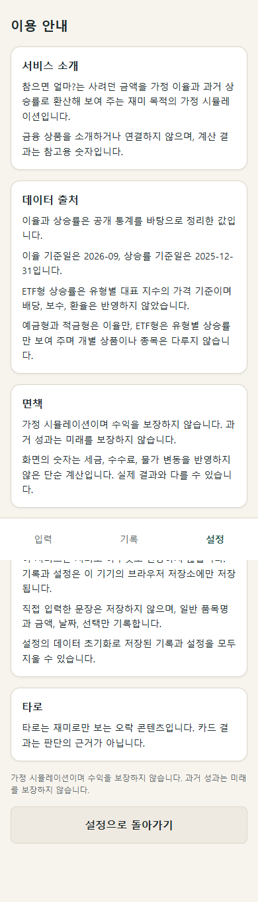

# 참으면 얼마?

사려던 금액을 가정 이율과 과거 지수 상승률로 환산해 3D 저금통과 함께 보여 주는 충동 소비 억제 웹앱이다. 서버 없이 정적 파일만으로 동작한다.

> 가정 시뮬레이션이며 수익을 보장하지 않습니다. 과거 성과는 미래를 보장하지 않습니다.

| 입력 | 결과(3D) | 결과(2D 폴백) | 기록 | 이용 안내 |
| --- | --- | --- | --- | --- |
|  |  |  |  |  |

스크린샷은 E2E 테스트가 390×844 뷰포트에서 저장한 화면이다.

## 주요 기능

- **입력**: 카테고리(배고픔, 스트레스, 보상, 충동)와 품목 칩을 고르거나 일반 명칭을 직접 입력하고 금액을 넣는다. 상호명이나 상품명으로 의심되는 입력은 거부한다.
- **환산** (3가지 방식)
  - 예금형: 일시 예치, 연 복리
  - 적금형: 매달 같은 금액을 넣는 월 복리
  - ETF 타임머신형: N년 전 초에 넣었다면 기준 연도 말에 얼마인지 계산한다. 기술주 ETF형과 대형주 ETF형의 과거 연간 상승률을 쓴다.
- **3D 저금통**: 원금 대비 배율만큼 코인을 쌓는다. 원금 코인과 불어난 코인은 색으로 구분한다. WebGL 미지원, 동작 줄이기 설정, 저사양 3D 끄기 설정에서는 같은 정보를 2D 그래픽으로 보여 준다.
- **한마디**: 미리 작성해 둔 문구 사전에서 카테고리, 금액 구간, 톤에 맞는 문구를 하나 고른다.
- **선택과 기록**: 참았어요 또는 샀어요/먹었어요를 기록한다. 누적 참은 금액, 연속 일수, 최근 7일 그래프를 보여 준다.
- **설정**: 가정 이율을 데이터 범위 안에서 조정할 수 있다. 저사양 3D 끄기, 데이터 초기화, 이용 안내 화면을 제공한다.

## 설계 근거

### 런타임 LLM을 쓰지 않은 이유

- 서버가 없는 정적 앱이라 API 키를 안전하게 둘 곳이 없다. 호출 비용과 응답 지연도 생긴다.
- 금융 수치 옆에 나오는 문장은 권유 표현, 상품명, 단정적 예언이 하나라도 섞이면 안 된다. 생성형 출력은 매번 달라서 이를 배포 전에 전수 검사할 수 없다.
- 사용자 입력을 외부로 보내지 않는다는 원칙(원문 미전송)과도 맞지 않는다.

### 문구를 사전 생성한 이유

- 문구 사전은 `src/data/messages.json` 288개, `src/data/messagesEtf.json` 48개다. 모두 빌드 전에 확정된 데이터다.
- 확정된 문구라서 단위 테스트로 전수 검사할 수 있다. 검사 항목은 자리표시자, 길이(60자), 숫자, 이모지, 명령과 권유 어미, 과장 표현, 금칙어, 시제, 조사 일치다.
- 문구가 화면에 그대로 나오므로 리뷰어가 파일 하나만 읽고 전체 톤을 확인할 수 있다.

### 계산과 문구를 분리한 이유

- 숫자는 `src/core/calc.ts`의 순수 함수에서만 나온다. 문구는 `{amount}`, `{future}`, `{years}`, `{startYear}` 같은 자리표시자만 가진다.
- 계산은 입력과 기대값으로 테스트하고, 문구는 형식 규칙으로 따로 테스트한다. 문구를 고쳐도 계산 결과는 바뀌지 않는다.
- 조사(을/를, 이/가 등)는 `src/core/template.ts`가 값의 받침에 맞춰 바꾼다.

### 상호명과 상품명을 전면 금지한 이유

- 실제 상품이나 브랜드 이름이 수익률 숫자 옆에 나오면 특정 상품을 권하는 것처럼 읽힐 수 있다. 그래서 예금과 적금은 이율만, 주식은 ETF 유형(기술주 ETF형, 대형주 ETF형)의 상승률만 보여 준다.
- 사용자가 입력한 상호명이 화면이나 저장소에 남는 것도 같은 문제라서 입력 단계에서 막는다.

### 입력 필터 방식 (`src/core/inputFilter.ts`)

- **원문 미저장**: 판정 결과에는 사전 품목의 id와 label만 담는다. 입력 칸은 확인을 누르면 판정 결과와 관계없이 비운다. 원문은 화면 표시, localStorage, 외부 전송 어디에도 쓰지 않는다(E2E로 확인).
- **사전 매칭**: 일반 품목 사전(`src/data/items.json`, 76개)과 대조한다. 품목명 그대로이거나 수량(2잔 등)과 일반 수식어(아이스, 양념 등)만 붙은 입력은 허용한다. 품목명에 알 수 없는 글자가 붙으면 상호로 의심해 거부한다. 품목명이 없으면 기타 소비로 처리한다.
- **해시 목록**: 금지 상호명 원문을 소스에 두지 않으려고 `scripts/banned-terms.txt`(저장소 사용자가 관리)를 32비트 해시로 바꾼 `src/data/blockedHashes.json`과 대조한다. 목록을 고치면 `npm run build:blocklist`를 실행한다. 두 파일의 동기화는 테스트로 확인한다.
- 영문이 들어간 입력은 상호명일 수 있어 거부하고, 한글 일반 명칭으로 입력하라고 안내한다.

## 아키텍처

```
src/
  core/        순수 로직
    calc.ts          예금형, 적금형, ETF 타임머신 계산과 시작 연도 범위
    coinCount.ts     배율 → 코인 수, 원금 코인과 불어난 코인 분리
    inputFilter.ts   직접 입력 판정(사전 매칭, 해시 대조)
    messagePick.ts   문구 선택
    template.ts      자리표시자 치환, 조사 보정
    copy.ts          고정 문구, 입력 안내, 이용 안내 문구
    format.ts, stats.ts, fallback.ts, textNorm.ts
  data/        정적 JSON (rates, returns, items, messages, messagesEtf, tarot, blockedHashes)
  scenes/      CoinStage(3D/2D 선택), PiggyBank(three.js, 지연 로드), CoinFallback2d(SVG)
  screens/     Input, Result, Choice, Log, Settings, Guide
  store/       localStorage 래퍼(허용 필드만 읽고 씀)
  styles/      tokens.css(디자인 토큰), app.css
scripts/       fetch-data.ts, scan-banned.ts, build-blocklist.ts, banned-terms.txt, allow-tokens.txt
tests/         unit(Vitest), e2e(Playwright)
docs/          PLAN, PROMPT_DEV, PROMPT_MESSAGES, SETUP, DATA_SOURCES, SUBMISSION, screenshots
```

데이터 흐름:

```
입력 화면
  ├─ 직접 입력 → inputFilter → { itemId, label, category }   (원문은 여기서 버림)
  └─ Draft { itemId, label, category, amount }
결과 화면
  ├─ calc: futureValueCompound / installmentFutureValue / timeMachine  ← rates.json, returns.json, 설정 이율
  ├─ coinSplit → CoinStage → PiggyBank(3D) 또는 CoinFallback2d(2D)
  └─ messagePick → fillTemplate  ← messages.json, messagesEtf.json
선택 화면 → store.addRecord { date, itemId, amount, choice } → localStorage
기록 화면 ← store.getRecords → stats(누적, 연속 일수, 7일 그래프)
```

화면 전환은 라우터 없이 `App.tsx`의 상태로 한다. 3D 모듈은 `React.lazy`로 분리해 결과 화면에서만 받는다.

## 데이터 정책

- **수집**: `npm run fetch:data`(`scripts/fetch-data.ts`)가 공개 통계를 받아 `src/data/rates.json`과 `src/data/returns.json`을 만든다. 값을 손으로 쓰지 않는다. 출처 URL, 이용 조건, 계산 방식은 `docs/DATA_SOURCES.md`에만 적는다. 이 파일은 앱 번들과 금칙어 스캔 대상에서 제외한다.
- **기준일**
  - 이율: 2026-09. 최근 12개월 월별 값의 중앙값을 기본값으로 쓰고, 값의 범위를 슬라이더 한계로 쓴다.
  - 상승률: 2025-12-31. 2000~2025년 연간 상승률이며, 진행 중인 해는 제외한다.
  - 수집일: 2026-11-23
- **한계**
  - ETF형 상승률은 유형별 대표 지수의 USD 가격 수익률이다. 실제 ETF 상품의 수익률이 아니다. 배당, 보수, 환율은 반영하지 않는다.
  - 예금형과 적금형은 상품별 분포가 아니라 공개 평균 수신금리로 근사했다. 세금은 반영하지 않는다.
  - 교차 검증 범위: 상승률은 두 번째 공개 자료와 52개 연도를 대조했고 차이는 모두 0%p였다(소수 둘째 자리 기준). 다만 기술주 ETF형의 대조 자료는 1차 출처를 인용하고 있어 완전한 독립 검증은 아니다. 이율은 같은 통계의 분기값과 월평균을 비교한 것이라 독립 출처 검증이 아니다.
  - 출처 없는 값은 `isSample: true`로 표시하고 화면에 샘플 데이터 배지를 단다. 현재 데이터에 샘플 값은 없다.

## 품질 보증

### 단위 테스트 (Vitest): 13개 파일, 146개

| 파일 | 개수 | 내용 |
| --- | --- | --- |
| calc.test.ts | 29 | 복리, 적금, 타임머신 계산, 경계값, 범위 오류, 시작 연도 범위 |
| inputFilter.test.ts | 21 | 상호명 거부, 일반 명칭 허용, 영문 거부, 결과에 원문 없음, 품목 사전 무결성, 해시 목록 동기화 |
| data.test.ts | 19 | rates, returns 스키마, 연도 연속성, isSample 일관성, 티커와 지수명 없음 |
| messages.test.ts | 15 | 문구 규칙(자리표시자, 길이, 권유 어미, 과장, 금칙어, 시제) |
| coinCount.test.ts | 13 | 코인 수 경계, 단조성, 원금 코인과 불어난 코인 분리 |
| stats.test.ts | 9 | 누적 금액, 연속 일수, 7일 집계 |
| fallback.test.ts | 7 | 2D 폴백 조건, WebGL과 동작 줄이기 감지 |
| messages.render.test.ts | 7 | 모든 품목 대입 시 조사 일치, 자리표시자 잔존 없음 |
| storage.test.ts | 7 | 허용 필드만 저장, 이율 보정, 손상 데이터 복구, 초기화 |
| format.test.ts | 6 | 원 단위 반올림, 콤마, 원과 퍼센트 표기 |
| messagePick.test.ts | 5 | 카테고리, 금액 구간, 톤별 문구 선택 |
| copy.test.ts | 4 | 이용 안내 필수 내용, 권유 어미, 금칙어 |
| template.test.ts | 4 | 자리표시자 치환, 조사 보정 |

### E2E (Playwright, Chromium): 2개 파일, 9개

- `flow.spec.ts` (3개): 상호명 거부, 원문 미표시와 미저장, 환산, 참았어요 기록, 기타 소비 처리, 이용 안내 이동
- `scene.spec.ts` (6개): 3D 캔버스와 대체 텍스트, 2D 폴백(WebGL 미지원, 동작 줄이기, 설정 토글), 2D 코인 색 구분, ETF 한마디 시제, ETF 시작 연도 범위
- 헤드리스에서는 소프트웨어 WebGL(swiftshader)로 3D를 렌더링한다.

### 금칙어 스캔 (`npm run scan:banned`)

- 대상: `src/` 전체(코드, JSON, CSS)
- 권유 표현(사세요, 넣으세요, 투자하세요, 매수, 매도 등)을 검사한다.
- 영문 대문자 2~5자 토큰은 티커 의심으로 본다. 허용 목록은 `scripts/allow-tokens.txt`다.
- `scripts/banned-terms.txt`의 상품명을 검사한다.
- 위반이 하나라도 있으면 종료 코드 1이다. 같은 검사 함수를 문구 단위 테스트에서도 쓴다.

### CI

- `.github/workflows/ci.yml`: push(main)와 PR마다 실행한다. 순서는 `npm ci` → 금칙어 스캔 → 단위 테스트 → 빌드 → Playwright 브라우저 설치 → E2E다.
- `.github/workflows/deploy.yml`: main 푸시 시 빌드해 GitHub Pages에 배포한다. CI와 별개 워크플로다.

## 실행 방법

Node.js 20 이상이 필요하다.

```bash
npm ci
npm run dev        # 개발 서버
npm run build      # 프로덕션 빌드(dist/)
npm run preview    # 빌드 결과 미리 보기
```

GitHub Pages처럼 하위 경로에 배포할 때는 `BASE_PATH`를 지정한다.

```bash
BASE_PATH=/chameumyeon-eolma/ npm run build
```

### 테스트 실행

```bash
npm test                          # 단위 테스트
npm run scan:banned               # 금칙어 스캔
npx playwright install chromium   # 최초 1회
npm run test:e2e                  # E2E(빌드 후 preview 서버로 실행)
```

스크린샷 갱신:

```bash
SCREENSHOTS=1 npm run test:e2e            # bash
$env:SCREENSHOTS='1'; npm run test:e2e    # PowerShell
```

## 가정 목록

개발 중 내린 가정을 Phase별로 기록한다. "(보정)"은 Phase 3 이후 고친 항목이다.

### Phase 0 데이터

- 기술주 ETF형은 미국 기술주 중심 대표 지수, 대형주 ETF형은 미국 대형주 대표 지수의 연간 가격 상승률로 대응시켰다. 구체적 지수는 `docs/DATA_SOURCES.md`에만 기록한다.
- 상승률은 USD 기준 가격 수익률이다. 배당, 환율, ETF 보수는 반영하지 않는다.
- 상승률 기간은 2000년부터 마지막 완결 연도(현재 2025년)까지다.
- 이율 구간은 상품별 분포 대신 한국은행 예금은행 수신금리(신규취급액 기준)의 최근 12개월 월별 평균과 최신월 만기 구간별 평균으로 근사했다. default는 12개월 중앙값이다.
- 이율 교차 검증은 같은 통계의 분기값과 월평균 비교로 대신했다. 독립된 두 번째 출처는 아니다.
- 공개 샘플 키로 수집할 수 있어 API 키 없이 동작한다. `.env`에 `ECOS_API_KEY`가 있으면 그 키를 쓴다.
- `npm run test:e2e`는 Phase 5 전까지 테스트가 없어도 통과한다(`--pass-with-no-tests`).
- 금칙어 스캔(`npm run scan:banned`)은 CI가 호출하므로 Phase 0에서 기본 규칙을 먼저 구현했다. 입력 필터 테스트 연동은 Phase 5에서 추가한다.

### Phase 1 코어

- `futureValueCompound`의 `annualRate`는 소수(2.88% → 0.0288)이고 연 복리다. 기간은 0~50년 정수, 이율은 0~1.
- 입력 금액은 0원 이상 1억 원 이하 정수만 받는다. 범위 밖이면 `RangeError`.
- 원 단위 반올림은 부동소수 오차를 소수 여섯째 자리에서 정리한 뒤 반올림한다.
- `timeMachine`은 시작 연도 1월 초에 넣어 데이터 마지막 연도(현재 2025년) 말까지 보유한 경우로 계산한다. 결과의 `endYear`가 기준 연도다. 구간에 값이 없는 연도가 있으면 `RangeError`.
- 금액 구간: 1만 원 미만 low, 5만 원 미만 mid, 그 이상 high.
- 적금형(매월 납입) 계산은 화면 설계와 함께 Phase 2에서 정한다.
- 입력 필터
  - 금칙어 원문을 src에 두지 않기 위해 `scripts/banned-terms.txt`를 32비트 해시로 바꾼 `src/data/blockedHashes.json`과 대조한다. 목록을 고치면 `npm run build:blocklist`를 실행한다(테스트가 동기화를 확인한다).
  - 영문이 들어간 입력은 상호명일 수 있어 거부한다.
  - 사전 품목명과 정확히 같거나, 수량(2잔, 한 마리)이나 일반 수식어(아이스, 양념, 큰 등)만 붙은 입력은 허용한다.
  - 사전 품목명에 알 수 없는 글자가 붙은 입력(예: 고유명+치킨)은 상호로 의심해 거부한다.
  - 품목명이 전혀 없는 입력은 기타 소비로 처리한다.
  - 결과에는 사전 label만 담고 입력 원문은 담지 않는다.
- 문구
  - `{amount}`와 `{future}`에는 "원"까지 포맷된 문자열이 들어간다고 보고, 뒤 조사는 받침형(이, 을, 은, 으로)으로 썼다.
  - `{item}` 뒤 조사는 `src/core/template.ts`의 `fillTemplate`이 받침에 맞춰 바꾼다.
  - messages.json과 tarot.json은 `docs/PROMPT_MESSAGES.md` 조건에 맞춰 직접 작성했다. 런타임 생성은 없다.

### Phase 2 화면

- 예금형: 입력 금액을 한 번 넣는 일시 예치, 연 복리.
- 적금형: 입력 금액을 매달 같은 금액으로 넣는다고 본다. 납입은 매월 초로 가정한다. 월 복리는 연 이율/12로 근사한다. 결과는 총 납입액과 예상 금액이다.
- ETF 타임머신형: 슬라이더 N년은 최근 N개 연도다(예: 5년이면 2021년 초부터 2025년 말까지). 화면에는 유형의 누적 상승률만 표시한다.
  - (보정) 시작 연도는 데이터 마지막 연도 직전까지만 고를 수 있다. ETF형 슬라이더는 2년부터 시작하고, 다른 모드에서 1년을 골랐다가 ETF형으로 바꾸면 2년으로 보인다. `timeMachine`도 마지막 연도 시작을 `RangeError`로 거부한다.
- 한마디의 `{amount}`는 입력 금액이다(적금형은 월 납입액). `{future}`는 예금형이나 적금형 예상 금액이다. ETF형은 과거 환산이라 문구 시제와 맞지 않으므로 한마디를 예금형 가정 기준으로 채우고 화면에 표시한다.
- 문구 톤(funny, calm, stern)은 무작위로 고르고, 입력이 바뀔 때만 새로 고른다.
- 기타 소비의 카테고리: 카테고리 칩을 골랐으면 그 카테고리, 아니면 충동(impulse).
- 직접 입력 원문은 입력 칸에만 잠시 있고, 확인을 누르면 판정 결과와 상관없이 비운다. 화면에는 사전 label만 표시한다.
- 연속 일수: 참았어요 기록이 있는 날이 이어진 일수. 오늘 기록이 없으면 어제부터 센다. 먹었어요만 있는 날은 연속이 끊긴다.
- 주간 그래프: 오늘을 포함한 최근 7일의 참았어요 금액.
- localStorage 스키마
  - `chameum.records.v1`: `[{ date: 'YYYY-MM-DD', itemId, amount, choice: 'saved' | 'spent' }]`
  - `chameum.settings.v1`: `{ depositRate, savingsRate, reduce3d }`
  - 읽을 때 허용 필드만 남기고 이율은 rates.json 범위로 보정한다.
- 설정의 저사양 3D 끄기는 값만 저장한다. 실제 동작은 Phase 3에서 붙인다.
- 디자인 값은 `src/styles/tokens.css`에만 둔다. 화면 스타일(`app.css`)은 토큰만 참조한다.
- 날짜는 기기 로컬 시간 기준이다.
- (보정) 이용 안내 화면은 설정에서 들어간다. 문구는 `src/core/copy.ts`의 `guideSections`에서 관리하고, 기준일은 rates.json과 returns.json의 asOf를 그대로 넣는다. 타로 안내 문구는 타로 화면(Phase 4)보다 먼저 넣었다.

### Phase 3 3D 저금통과 보정

- ETF 타임머신형 한마디는 `src/data/messagesEtf.json`(카테고리 4 × 톤 3 × 4개)에서 고른다.
  - 과거 시제 가정법만 쓴다. 자리표시자는 `{item}`, `{amount}`, `{startYear}`, `{future}`이다.
  - 과거 상승률이 음수인 구간도 있을 수 있어 "자라다", "여유" 같은 성장 단정 표현은 쓰지 않는다(테스트로 확인).
  - (보정) "지금"이나 `{future}` 뒤에 과거형 어미가 오는 혼합 시제는 "그때 넣었다면 지금은 약 N원이 되어 있을 거예요" 형태로 통일했다. stern 톤은 "겁니다"로 끝낸다(테스트로 확인).
- 참지 못한 경우의 버튼과 기록 라벨: 배고픔(hunger) 품목은 "먹었어요", 그 외와 기타 소비는 "샀어요".
- 과장 표현과 특정 품목에만 맞는 비유(놀랄, 마술, 장바구니, 할부 등)는 두 문구 풀 모두에서 테스트로 막는다.
- items.json 라벨은 띄어쓰기를 반영했다(예: 게임 아이템). 입력 필터는 공백을 지우고 비교하므로 붙여 써도 같은 품목으로 인식한다.
- 코인 수(`src/core/coinCount.ts`)
  - 배율 = 환산 금액 / 원금. 적금형의 원금은 총 납입액이다.
  - 배율 1 이상: 10 + round((배율 − 1) × 40), 상한 80개.
  - 배율 1 미만: round(10 × 배율), 최소 1개.
  - 원금이나 결과가 0 이하이면 0개.
- 2D 폴백 조건: WebGL 미지원, 설정의 저사양 3D 끄기, `prefers-reduced-motion: reduce`. 3D 로딩이나 렌더링이 실패해도 2D로 바꾼다.
- 3D(`src/scenes/PiggyBank.tsx`)
  - 박스, 구, 실린더만 사용하고 외부 모델 파일은 없다. 카메라 조작, 점수, 승패도 없다.
  - 색은 tokens.css 변수에서 읽는다.
  - `frameloop="demand"`로 코인 개수를 보간하는 동안만 프레임을 요청하고, 목표에 닿으면 멈춘다. 렌더 해상도 배율은 최대 2.
  - 직접 만든 지오메트리와 재질은 언마운트 시 해제한다.
- 3D 모듈은 `React.lazy`로 분리해 결과 화면에서만 로드한다. drei는 쓰지 않는다(의존성은 남겨 둠).
- 3D 영역에는 "원금 코인 N개, 불어난 코인 M개 쌓임" 대체 텍스트를 단다.
- (보정) 원금 코인과 불어난 코인을 색으로 구분한다(`coinSplit`).
  - 배율 1 이상이면 원금 코인은 10개(COIN_BASE)이고 나머지가 불어난 코인이다. 배율 1 미만이면 전부 원금 코인이다. 배율 환산식(COIN_GROWTH)은 바꾸지 않았다.
  - 색은 tokens.css의 `--color-coin-principal*`, `--color-coin-grown*`이다. 원금은 회색 계열, 불어난 만큼은 금색 계열로 명도 차이를 두었다. 3D와 2D 폴백에 같이 적용하고 범례를 붙였다.
- E2E 스크린샷은 `SCREENSHOTS=1`일 때만 `docs/screenshots/`에 저장한다.
  - bash: `SCREENSHOTS=1 npm run test:e2e`
  - PowerShell: `$env:SCREENSHOTS='1'; npm run test:e2e`
- 헤드리스 E2E는 소프트웨어 WebGL(swiftshader) 실행 인자를 쓴다.

### 배포 준비

- `vite.config.ts`의 `base`는 환경변수 `BASE_PATH`로 받는다. 없으면 `/`이다.
- `.github/workflows/deploy.yml`은 main 푸시 시 `BASE_PATH=/<저장소 이름>/`으로 빌드해 GitHub Pages에 배포한다. 검사용 `ci.yml`과 따로 동작한다.
- 저장소 설정의 Pages 소스를 GitHub Actions로 지정해야 배포된다.
- Windows Git Bash에서 로컬로 확인할 때는 경로 자동 변환을 꺼야 한다: `MSYS2_ENV_CONV_EXCL=BASE_PATH BASE_PATH=/chameumyeon-eolma/ npm run build`

## 면책

가정 시뮬레이션이며 수익을 보장하지 않습니다. 과거 성과는 미래를 보장하지 않습니다.

ETF형 결과는 지수 가격 기준이며 배당, 보수, 환율은 반영하지 않았습니다. 이 앱은 금융 상품을 소개하거나 권유하지 않습니다.
