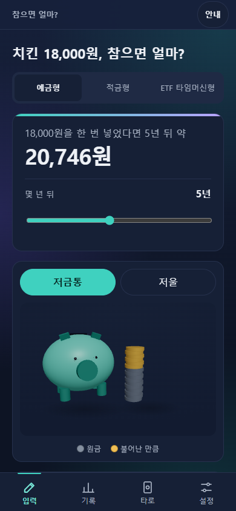
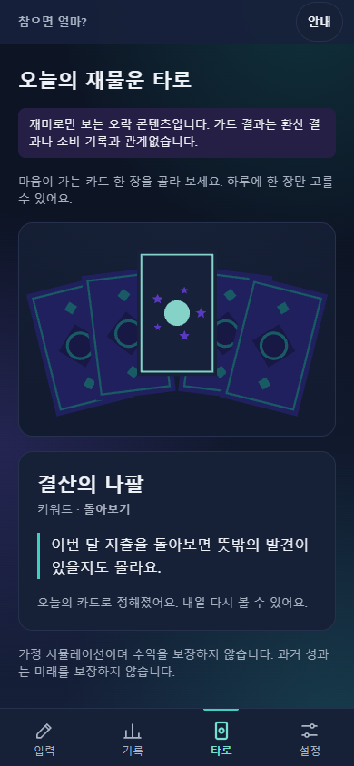
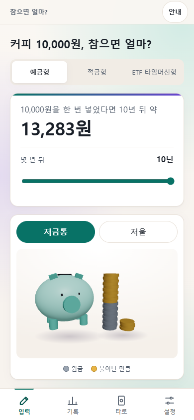
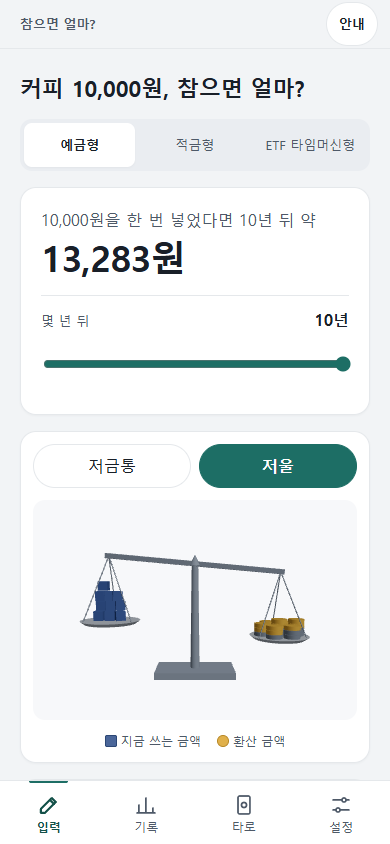

# 참으면 얼마?

사려던 금액을 가정 이율과 과거 지수 상승률로 환산해 3D 저금통과 저울로 보여 주는 충동 소비 억제 웹앱이다. 서버 없이 정적 파일만으로 동작한다.

> 가정 시뮬레이션이며 수익을 보장하지 않습니다. 과거 성과는 미래를 보장하지 않습니다.

## 요약

[](https://github.com/Woogie-Gim/chameumyeon-eolma/actions/workflows/ci.yml)

- 금액과 품목을 넣으면 가정 이율과 ETF 유형 과거 상승률로 환산해 3D 저금통과 저울로 보여 주는 정적 웹앱
- 서버, 런타임 LLM, 외부 API 호출 없음. 문구는 사전 작성한 JSON에서 고르고 기록은 기기 localStorage에만 저장

빠른 실행:

```bash
npm ci
npm run dev
npm test
```

앱인토스 제출 현황:

- 카테고리: 비게임, 금융 > 소비 > 가계부/절약
- 심사 요청: 2026-11-25
- 승인: 2026-11-25
- 출시: 2026-11-25
- 번들 방식: 웹 번들(.ait)

검증 요약:

| 항목 | 결과 |
| --- | --- |
| 단위 테스트 (`npm test`) | 28개 파일, 363개 통과 |
| E2E (`npm run test:e2e`) | 11개 파일, 54개 중 52개 통과, 2개 건너뜀(스크린샷 생성용, `SCREENSHOTS=1`일 때만 실행) |
| 금칙어 스캔 (`npm run scan:banned`) | 검사 파일 61개, 위반 0건 |
| 린트 (`npm run lint`) | 경고 0건, 오류 0건 |
| Lighthouse 13.6.0 (모바일, 첫 화면, 2026-11-25 측정) | 성능 100, 접근성 100, 권장사항 100 |
| 번들 크기 (`npm run build`) | 메인 JS 338.51 kB(gzip 100.01 kB), CSS 20.58 kB(gzip 4.80 kB), three 청크 918.31 kB(gzip 242.57 kB, 3D 화면에서만 로드), `.ait` 약 423 kB(압축 메타데이터로 빌드마다 몇 바이트 달라짐) |

수치 측정일: 2026-11-26(Lighthouse 제외). 상세 내용은 아래 [품질 보증](#품질-보증)에 있다.

## 실행 화면

| 입력(라이트) | 결과(라이트) | 타로 고르기 전(라이트) | 타로 고른 뒤(라이트) |
| --- | --- | --- | --- |
|  |  |  |  |

| 입력(다크) | 결과(다크) | 타로 고르기 전(다크) | 타로 고른 뒤(다크) |
| --- | --- | --- | --- |
|  |  |  |  |

| 결과(3D 저금통) | 결과(3D 저울) | 결과(2D 폴백) | 기록 | 이용 안내 |
| --- | --- | --- | --- | --- |
|  |  |  |  |  |

스크린샷은 E2E 테스트가 모바일 뷰포트(390×844) 한 화면 크기로 저장한 것이다. 각 화면의 맨 위에서 캡처하므로 아래쪽 내용은 잘릴 수 있다. 라이트와 다크는 `screenshots.spec.ts`가 테마마다 새 브라우저 컨텍스트로 찍는다.

## 주요 기능

- **입력**: 카테고리(배고픔, 스트레스, 보상, 충동)와 품목 칩을 고르거나 일반 명칭을 직접 입력하고 금액을 넣는다. 상호명이나 상품명으로 의심되는 입력은 거부한다.
- **환산** (3가지 방식)
  - 예금형: 일시 예치, 연 복리
  - 적금형: 매달 같은 금액을 넣는 월 복리
  - ETF 타임머신형: N년 전 초에 넣었다면 기준 연도 말에 얼마인지 계산한다. 기술주 ETF형과 대형주 ETF형의 과거 연간 상승률을 쓴다.
- **3D 저금통**: 원금 대비 배율만큼 코인을 쌓는다. 원금 코인과 불어난 코인은 색으로 구분한다. 금액은 카운트업으로 보여 주고, 코인이 다 쌓이면 맨 위 코인이 잠깐 반짝인다. WebGL 미지원, 동작 줄이기 설정, 저사양 3D 끄기 설정에서는 같은 정보를 2D 그래픽으로 보여 준다.
- **3D 저울**: 결과 화면에서 저금통과 저울을 바꿔 볼 수 있다(기본은 저금통). 한쪽 접시에는 지금 쓰는 금액 더미, 다른 쪽에는 환산 금액 코인 더미를 올리고 두 금액의 비율만큼 기울인다. ETF형이 하락한 구간에서는 쓰는 금액 쪽으로 기운다. 2D 폴백은 막대 두 개 비교다.
- **한마디**: 미리 작성해 둔 문구 사전에서 카테고리, 금액 구간, 톤에 맞는 문구를 하나 고른다.
- **선택과 기록**: 참았어요 또는 샀어요/먹었어요를 기록한다. 누적 참은 금액, 연속 일수, 최근 7일 그래프를 보여 준다.
- **재물운 타로**: 화면에 들어오면 22장 중 5장을 무작위로 골라 순서를 섞어 뒷면으로 펼친다. 한 장을 탭하면 효과음과 함께 그 카드가 뒤집히고 나머지는 흐려진다. 카드 이름, 키워드, 소비 조언 한 줄을 본다. 고른 카드는 그날 하루 고정되고, 다시 들어오면 펼침 없이 오늘 카드와 "내일 다시 볼 수 있어요" 안내를 보여 준다. 재미로만 보는 오락 콘텐츠이며 환산 결과와 소비 기록에는 영향이 없다. 다시 뽑기, 포인트, 등급, 뽑기 기록은 없다. 3D 펼침과 CSS 2D 폴백이 같은 선택 흐름(탭, 방향키와 엔터)을 제공한다.
- **설정**: 가정 이율을 데이터 범위 안에서 조정할 수 있다. 저사양 3D 끄기, 효과음(진동 포함) 켜고 끄기, 데이터 초기화, 이용 안내 화면을 제공한다.
- **효과음**: 음원 파일 없이 Web Audio API로 짧은 톤을 합성한다(버튼 탭, 결과 공개, 카드 넘김, 입력 오류). 지원하는 기기에서는 짧은 진동도 함께 낸다. 기본 켜짐, 볼륨은 작다.

## 설계 근거

### 런타임 LLM을 쓰지 않은 이유

- 서버가 없는 정적 앱이라 API 키를 안전하게 둘 곳이 없다. 호출 비용과 응답 지연도 생긴다.
- 금융 수치 옆에 나오는 문장은 권유 표현, 상품명, 단정적 예언이 하나라도 섞이면 안 된다. 생성형 출력은 매번 달라서 이를 배포 전에 전수 검사할 수 없다.
- 사용자 입력을 외부로 보내지 않는다는 원칙(원문 미전송)과도 맞지 않는다.

### 문구를 사전 생성한 이유

- 문구 사전은 `src/data/messages.json` 288개, `src/data/messagesEtf.json` 48개다. 모두 빌드 전에 확정된 데이터다.
- 확정된 문구라서 단위 테스트로 전수 검사할 수 있다. 검사 항목은 자리표시자, 길이(60자), 숫자, 이모지, 명령과 권유 어미, 과장 표현, 금칙어, 시제, 조사 일치다.
- 문구가 화면에 그대로 나오므로 리뷰어가 파일 하나만 읽고 전체 톤을 확인할 수 있다.

### 계산과 문구를 분리한 이유

- 숫자는 `src/core/calc.ts`의 순수 함수에서만 나온다. 문구는 `{amount}`, `{future}`, `{years}`, `{startYear}` 같은 자리표시자만 가진다.
- 계산은 입력과 기대값으로 테스트하고, 문구는 형식 규칙으로 따로 테스트한다. 문구를 고쳐도 계산 결과는 바뀌지 않는다.
- 조사(을/를, 이/가 등)는 `src/core/template.ts`가 값의 받침에 맞춰 바꾼다.

### 상호명과 상품명을 전면 금지한 이유

- 실제 상품이나 브랜드 이름이 수익률 숫자 옆에 나오면 특정 상품을 권하는 것처럼 읽힐 수 있다. 그래서 예금과 적금은 이율만, 주식은 ETF 유형(기술주 ETF형, 대형주 ETF형)의 상승률만 보여 준다.
- 사용자가 입력한 상호명이 화면이나 저장소에 남는 것도 같은 문제라서 입력 단계에서 막는다.

### 입력 필터 방식 (`src/core/inputFilter.ts`)

- **원문 미저장**: 판정 결과에는 사전 품목의 id와 label만 담는다. 입력 칸은 확인을 누르면 판정 결과와 관계없이 비운다. 원문은 화면 표시, localStorage, 외부 전송 어디에도 쓰지 않는다(E2E로 확인).
- **사전 매칭**: 일반 품목 사전(`src/data/items.json`, 76개)과 대조한다. 품목명 그대로이거나 수량(2잔 등)과 일반 수식어(아이스, 양념 등)만 붙은 입력은 허용한다. 품목명에 알 수 없는 글자가 붙으면 상호로 의심해 거부한다. 품목명이 없으면 기타 소비로 처리한다.
- **해시 목록**: 금지 상호명 원문을 소스에 두지 않으려고 `scripts/banned-terms.txt`(저장소 사용자가 관리)를 32비트 해시로 바꾼 `src/data/blockedHashes.json`과 대조한다. 목록을 고치면 `npm run build:blocklist`를 실행한다. 두 파일의 동기화는 테스트로 확인한다.
- 영문이 들어간 입력은 상호명일 수 있어 거부하고, 한글 일반 명칭으로 입력하라고 안내한다.

## 아키텍처

```
src/
  core/        순수 로직
    calc.ts          예금형, 적금형, ETF 타임머신 계산과 시작 연도 범위
    coinCount.ts     배율 → 코인 수, 원금 코인과 불어난 코인 분리
    scaleTilt.ts     두 금액 비율 → 저울 기울기, 대체 텍스트
    tarot.ts         5장 무작위 펼침(난수 주입 가능), 오늘의 카드 고정 판정, 부채꼴 배치
    inputFilter.ts   직접 입력 판정(사전 매칭, 해시 대조)
    messagePick.ts   문구 선택
    template.ts      자리표시자 치환, 조사 보정
    copy.ts          고정 문구, 입력 안내, 이용 안내 문구
    countUp.ts       결과 금액 카운트업 보간
    route.ts         경로와 화면 매핑, 딥링크 경로 변형과 해시, 쿼리 대체 해석
    amount.ts        금액 입력 해석(소수점 버림, 쉼표와 전각 처리, 범위 안내)
    today.ts         날짜 키와 날짜 갱신 판정
    format.ts, stats.ts, fallback.ts, textNorm.ts
  data/        정적 JSON (rates, returns, items, messages, messagesEtf, tarot, blockedHashes)
  scenes/      useUse3d(3D/2D 판정 훅), SceneBoundary(3D 실패 시 폴백), SceneLoading(3D 로딩 중 2D 표시)
               CoinStage → PiggyBank(3D, 지연 로드) / CoinFallback2d(SVG)
               ScaleStage → Scale(3D, 지연 로드) / ScaleFallback2d(막대 SVG)
               TarotSpreadStage(공통 버튼 레이어) → TarotSpread3d(3D 펼침, 지연 로드) / 버튼 안 SVG 카드(CSS 뒤집기)
               TarotStage → TarotCard(오늘 이미 고른 카드, 3D 지연 로드) / TarotFallback2d
               SceneLights(세 장면 공용 조명), spreadMotion(펼침 들어 올림과 흐림 값)
  hooks/       useToday(오늘 날짜 상태, 복귀 시 갱신), useCountUp(금액 카운트업)
  sound/       sound.ts(SoundPlayer, Web Audio 합성 효과음과 진동), soundContext.ts(React 컨텍스트)
  screens/     Input, Result, Choice, Log, Tarot, Settings, Guide, AppErrorBoundary
  store/       localStorage 래퍼(허용 필드만 읽고 씀, 저장소를 못 쓰면 메모리 대체)
  styles/      tokens.css(디자인 토큰), app.css
scripts/       fetch-data.ts, scan-banned.ts, build-blocklist.ts, make-icons.ts, banned-terms.txt, allow-tokens.txt
               make-logo.ts, make-banner.ts, store-banner.html, console-fields.ts, pngSize.ts (스토어 자산과 콘솔 입력값)
tests/         unit(Vitest), e2e(Playwright), store(스토어 스크린샷 촬영, npm run store:screens)
docs/          PLAN, PROMPT_DEV, PROMPT_MESSAGES, SETUP, DATA_SOURCES, SUBMISSION, screenshots
```

데이터 흐름:

```
진입 경로 → route.ts → / 입력, /tarot 타로, /record 기록, /settings 설정, /info 이용 안내
입력 화면
  ├─ 직접 입력 → inputFilter → { itemId, label, category }   (원문은 여기서 버림)
  └─ Draft { itemId, label, category, amount }
결과 화면
  ├─ calc: futureValueCompound / installmentFutureValue / timeMachine  ← rates.json, returns.json, 설정 이율
  ├─ 비교 쌍 { 원금 또는 총 납입액, 환산 금액 }
  │    ├─ coinSplit → CoinStage → PiggyBank(3D) 또는 CoinFallback2d(2D)
  │    └─ scaleTilt → ScaleStage → Scale(3D) 또는 ScaleFallback2d(2D)
  └─ messagePick → fillTemplate  ← messages.json, messagesEtf.json
선택 화면 → store.addRecord { date, itemId, amount, choice } → localStorage
기록 화면 ← store.getRecords → stats(누적, 연속 일수, 7일 그래프)
타로 화면 ← toDateKey(오늘) + store.getTarot → resolveToday
  ├─ 오늘 기록 있음 → 오늘 카드 + 내일 안내
  └─ 없음 → drawSpread(Math.random) 5장 → 한 장 고르기 → store.saveTarot { date, cardId }   (환산, 기록과 독립)
          뒤집기 → store.saveTarot { date, cardId }   (한 건 덮어쓰기)
```

화면 이동은 라우터 라이브러리 없이 history API로 경로를 맞춘다(`src/core/route.ts`).

- 경로: `/` 입력, `/tarot` 타로, `/record` 기록, `/settings` 설정, `/info` 이용 안내
- 결과와 선택 화면은 경로가 없고 `/`에 history 항목만 쌓는다. 뒤로가기로 입력값이 남은 입력 화면에 돌아간다
- 없는 경로는 홈으로 열고 주소도 홈으로 교정한다. 딥링크 경로 변형, 해시, 쿼리(`?page=`)도 해석한다
- base는 `import.meta.env.BASE_URL`을 써서 루트 배포와 하위 경로 배포가 같은 코드로 동작한다

3D 모듈(PiggyBank, Scale, TarotSpread3d, TarotCard)은 `React.lazy`로 분리해 필요한 화면에서만 받는다.

## 데이터 정책

- **수집**: `npm run fetch:data`(`scripts/fetch-data.ts`)가 공개 통계를 받아 `src/data/rates.json`과 `src/data/returns.json`을 만든다. 값을 손으로 쓰지 않는다. 출처 URL, 이용 조건, 계산 방식은 `docs/DATA_SOURCES.md`에만 적는다. 이 파일은 앱 번들과 금칙어 스캔 대상에서 제외한다.
- **기준일**
  - 이율: 2026-09. 최근 12개월 월별 값의 중앙값을 기본값으로 쓰고, 값의 범위를 슬라이더 한계로 쓴다.
  - 상승률: 2025-12-31. 2000~2025년 연간 상승률이며, 진행 중인 해는 제외한다.
  - 수집일: 2026-11-23
- **한계**
  - ETF형 상승률은 유형별 대표 지수의 USD 가격 수익률이다. 실제 ETF 상품의 수익률이 아니다. 배당, 보수, 환율은 반영하지 않는다.
  - 예금형과 적금형은 상품별 분포가 아니라 공개 평균 수신금리로 근사했다. 세금은 반영하지 않는다.
  - 교차 검증 범위: 상승률은 두 번째 공개 자료와 52개 연도를 대조했고 차이는 모두 0%p였다(소수 둘째 자리 기준). 다만 기술주 ETF형의 대조 자료는 1차 출처를 인용하고 있어 완전한 독립 검증은 아니다. 이율은 같은 통계의 분기값과 월평균을 비교한 것이라 독립 출처 검증이 아니다.
  - 출처 없는 값은 `isSample: true`로 표시하고 화면에 샘플 데이터 배지를 단다. 현재 데이터에 샘플 값은 없다.

## 품질 보증

### 단위 테스트 (Vitest): 28개 파일, 363개

| 파일 | 개수 | 내용 |
| --- | --- | --- |
| contrast.test.ts | 58 | tokens.css 대비(라이트, 다크): 텍스트 19조합, 포커스 외곽선 4조합, 배경 그라데이션 양 끝과 도형 겹침 합성색 위 글자와 포커스 모두 4.5:1 |
| route.test.ts | 35 | 경로와 화면 매핑, 홈 변형, 없는 경로와 결과 경로는 홈, base 붙은 경로, 해시와 쿼리 대체 해석, 교정 시 page만 제거, 하위 경로 배포 |
| calc.test.ts | 29 | 복리, 적금, 타임머신 계산, 경계값, 범위 오류, 시작 연도 범위 |
| tarot.test.ts | 26 | 5장 무작위 펼침(중복 없음, 범위, 주입 난수 재현성, 22장 모두 등장, 경계 난수), 오늘의 카드 고정, 부채꼴 배치(무대 안, 44px 노출, 좁으면 기울기 축소), 들어 올림, 조언 자리표시자 없음, 타로 문구 금칙어 |
| inputFilter.test.ts | 21 | 상호명 거부, 일반 명칭 허용, 영문 거부, 결과에 원문 없음, 품목 사전 무결성, 해시 목록 동기화 |
| data.test.ts | 19 | rates, returns 스키마, 연도 연속성, isSample 일관성, 티커와 지수명 없음 |
| storage.test.ts | 17 | 허용 필드만 저장, 이율 보정, 효과음 설정, 손상 데이터 복구, 초기화, 타로 저장, 저장소 차단과 용량 초과 시 메모리 대체 |
| messages.test.ts | 15 | 문구 규칙(자리표시자, 길이, 권유 어미, 과장, 금칙어, 시제) |
| scanBanned.test.ts | 13 | 티커 규칙 범위(식별자, 주석, 모듈 경로, CSS 통과 / 문자열, 템플릿, JSX 텍스트, 데이터 JSON 실패), 권유 표현과 상품명은 전체 적용, 줄 번호 |
| coinCount.test.ts | 13 | 코인 수 경계, 단조성, 원금 코인과 불어난 코인 분리 |
| scaleTilt.test.ts | 12 | 저울 기울기: 0원, 같은 금액, 비율 상한과 하한 경계, 하락 구간, 잘못된 입력, 대체 텍스트 |
| sound.test.ts | 11 | 가짜 AudioContext 주입: 첫 재생 전 생성 없음, 종류별 톤 수와 길이, 작은 볼륨, 꺼짐이면 소리와 진동 없음, 생성 실패와 재생 예외 무시, suspended면 resume, 진동 패턴과 진동 예외 무시 |
| copy.test.ts | 10 | 이용 안내 필수 내용, 타로 고지, 개인정보, 오류와 저장소와 금액 안내 문구의 권유 어미와 금칙어 |
| amount.test.ts | 10 | 금액 입력: 0, 음수, 1억 초과, 소수점, 쉼표와 원, 전각, 지수 표기, 빈 값 |
| stats.test.ts | 9 | 누적 금액, 연속 일수, 7일 집계 |
| fallback.test.ts | 8 | 2D 폴백 조건 전체 조합, WebGL과 동작 줄이기 감지 |
| countUp.test.ts | 7 | 카운트업 곡선, 시작과 끝, 정수 중간값, 감소 방향, 처음 공개 1초 이내 |
| messages.render.test.ts | 7 | 모든 품목 대입 시 조사 일치, 자리표시자 잔존 없음 |
| format.test.ts | 6 | 원 단위 반올림, 콤마, 원과 퍼센트 표기 |
| today.test.ts | 5 | 날짜 갱신 판정(같은 날, 자정, 월과 연 경계, 시계 역행), 타로 오늘의 카드 고정 연동 |
| storeAssets.test.ts | 5 | 스토어 로고, 세로형 스크린샷, 가로형 배너 픽셀 크기, 촬영 뷰포트 비율, 배너 문구 금칙어 |
| meta.test.ts | 5 | index.html 메타(설명, 뷰포트, 테마 색, OG), 자체 제작 파비콘, OG와 아이콘 크기 |
| messagePick.test.ts | 5 | 카테고리, 금액 구간, 톤별 문구 선택 |
| template.test.ts | 4 | 자리표시자 치환, 조사 보정 |
| sceneColors.test.ts | 4 | 3D 색을 tokens.css 변수에서 읽기, 없으면 기본값 |
| appErrorBoundary.test.tsx | 4 | 렌더 오류 안내 화면, 오류 원문 미노출, 다시 시도 복구, 반복 실패 시 새로고침(happy-dom) |
| console.test.ts | 3 | 콘솔 입력값 금칙어, SUBMISSION.md 표시 구간과 console.json 일치, 주요 기능 주소와 앱 경로 |
| contextLost.test.ts | 2 | WebGL 컨텍스트 소실 이벤트 감지 |

### E2E (Playwright, Chromium): 11개 파일, 54개(스크린샷 2개는 `SCREENSHOTS=1`일 때만 실행, 그 외 실행 시 건너뜀)

- `flow.spec.ts` (3개): 상호명 거부, 원문 미표시와 미저장, 환산, 참았어요 기록, 기타 소비 처리, 이용 안내 이동
- `scene.spec.ts` (8개): 3D 캔버스와 대체 텍스트, 2D 폴백(WebGL 미지원, 동작 줄이기, 설정 토글), 2D 코인 색 구분, ETF 한마디 시제, ETF 시작 연도 범위, 저금통/저울 전환, 저울 2D 폴백
- `tarot.spec.ts` (5개): 5장 펼침이 한 화면에 들어오고 카드마다 44px 이상 노출, 로빙 tabindex와 방향키(처음과 끝 순환, Home/End) → 엔터로 고르기 → 이름에 포커스, 나머지 흐림과 비활성, 다른 카드 눌러도 그대로, 저장 키는 날짜와 카드 id만, 새로고침하면 펼침 없이 같은 카드와 내일 안내 / 어제 기록이면 다시 펼침 / WebGL 미지원 CSS 2D 같은 흐름 / 3D 펼침(투명 버튼 레이어)과 동작 줄이기 2D / 자정 넘김 후 앱 복귀 시 새 펼침(가짜 시계)
- `loading.spec.ts` (4개): 첫 화면에서 three 청크 미요청, 저금통/저울/타로 펼침 3D 청크를 붙잡아 두는 동안 2D 대체 화면과 준비 중 표시(타로는 로딩 중에도 고르기 가능), 이후 3D 전환
- `stability.spec.ts` (7개): localStorage 차단과 용량 초과에서 흐름 동작과 안내, WebGL 컨텍스트 소실 시 저금통/저울/타로 2D 전환, 금액 입력 경계값과 붙여넣기
- `sound.spec.ts` (3개): 첫 입력 전 AudioContext 없음과 이후 한 번만 생성, 효과음 끄기 저장과 새로고침 후 유지, 오디오와 진동이 막힌 환경에서 오류 없음
- `a11y.spec.ts` (4개): 7개 화면 터치 영역 44px, 키보드 탐색과 포커스 외곽선, 3D 대체 텍스트와 타로 카드 버튼 이름, 동작 줄이기
- `guide.spec.ts` (3개): 어느 화면에서든 안내 열기와 돌아가기, 고정 면책과 개인정보 문구, 입력 화면 개인정보 문구
- `routing.spec.ts` (9개): 주요 기능 경로로 바로 열기와 새로고침, 탭 이동 경로와 뒤로가기/앞으로가기 복원, 결과 화면 뒤로가기와 새로고침, 없는 경로는 홈으로 교정, 경로 변형 진입 교정(3개), `?debug=1` 진입도 같은 화면이고 진단 패널 없음
- `base-path.spec.ts` (6개, `base-path` 프로젝트): `BASE_PATH=/chameumyeon-eolma/` 빌드에서 자산 404 없음, 새로고침과 딥링크, 404.html, 주요 기능 경로, 탭 이동 경로에 base 붙음, 없는 경로는 base로 교정
- `screenshots.spec.ts` (2개): 입력, 결과, 타로 고르기 전과 후를 라이트와 다크로 각각 새 컨텍스트에서 캡처
- 헤드리스에서는 소프트웨어 WebGL(swiftshader)로 3D를 렌더링한다. 3D 캔버스가 처음 뜨기를 기다리는 단언은 `SCENE_TIMEOUT`(15초)을 쓴다.

### 금칙어 스캔 (`npm run scan:banned`)

- 권유 표현(사세요, 넣으세요, 투자하세요, 매수, 매도 등)과 `scripts/banned-terms.txt`의 상품명은 `src/` 전체 텍스트(코드, 주석, JSON, CSS)에서 검사한다.
- 영문 대문자 2~5자 토큰은 티커 의심으로 본다. 대상은 화면에 보일 수 있는 문자열과 `src/data/*.json`이다.
  - 코드 파일은 AST(`rolldown/parseAst`)로 문자열 리터럴, 템플릿 문자열, JSX 텍스트(속성 문자열 포함)만 뽑아 검사한다.
  - 코드 식별자, 주석, import 경로, CSS는 티커 검사에서 제외한다.
  - 허용 목록은 `scripts/allow-tokens.txt`(ETF, NFC)다.
- 위반이 하나라도 있으면 종료 코드 1이다. 같은 검사 함수를 문구 단위 테스트에서도 쓴다.

### CI

- `.github/workflows/ci.yml`: push(main)와 PR마다 실행한다. 순서는 `npm ci` → 금칙어 스캔 → 단위 테스트 → 빌드 → Playwright 브라우저 설치 → E2E다.
- `.github/workflows/deploy.yml`: main 푸시 시 빌드해 GitHub Pages에 배포한다. CI와 별개 워크플로다.
- 액션은 node24 런타임 메이저 버전을 쓴다(checkout v7, setup-node v7, configure-pages v6, upload-pages-artifact v5, deploy-pages v5). 빌드 Node 버전은 24다.

## 실행 방법

Node.js 20 이상이 필요하다.

```bash
npm ci
npm run dev        # 개발 서버
npm run build      # 타입 검사, 프로덕션 빌드(dist/), 앱인토스 웹 번들(chameumyeon-eolma.ait)
npm run preview    # 빌드 결과 미리 보기
```

GitHub Pages처럼 하위 경로에 배포할 때는 `BASE_PATH`를 지정한다.

```bash
BASE_PATH=/chameumyeon-eolma/ npm run build
```

### 테스트 실행

```bash
npm test                          # 단위 테스트
npm run lint                      # oxlint
npm run scan:banned               # 금칙어 스캔
npx playwright install chromium   # 최초 1회
npm run test:e2e                  # E2E(루트 빌드 4173, BASE_PATH 빌드 4174 preview 서버로 실행)
```

스크린샷 갱신:

```bash
SCREENSHOTS=1 npm run test:e2e            # bash
$env:SCREENSHOTS='1'; npm run test:e2e    # PowerShell
```

### 그 밖의 스크립트

```bash
npm run fetch:data        # 이율, 상승률 데이터 수집(src/data/rates.json, returns.json)
npm run build:blocklist   # scripts/banned-terms.txt → src/data/blockedHashes.json
npm run store:screens     # 스토어 세로형 스크린샷(docs/store/screenshots/)
npm run store:logo        # 스토어 로고
npm run store:banner      # 스토어 가로형 배너
npm run store:console     # 콘솔 입력값(docs/store/console.json → docs/SUBMISSION.md 표시 구간)
npm run deploy            # 앱인토스 배포(ait deploy)
```

## 가정 목록

개발 중 내린 가정을 Phase별로 기록한다. "(보정)"은 Phase 3 이후 고친 항목이다.

### Phase 0 데이터

- 기술주 ETF형은 미국 기술주 중심 대표 지수, 대형주 ETF형은 미국 대형주 대표 지수의 연간 가격 상승률로 대응시켰다. 구체적 지수는 `docs/DATA_SOURCES.md`에만 기록한다.
- 상승률은 USD 기준 가격 수익률이다. 배당, 환율, ETF 보수는 반영하지 않는다.
- 상승률 기간은 2000년부터 마지막 완결 연도(현재 2025년)까지다.
- 이율 구간은 상품별 분포 대신 한국은행 예금은행 수신금리(신규취급액 기준)의 최근 12개월 월별 평균과 최신월 만기 구간별 평균으로 근사했다. default는 12개월 중앙값이다.
- 이율 교차 검증은 같은 통계의 분기값과 월평균 비교로 대신했다. 독립된 두 번째 출처는 아니다.
- 공개 샘플 키로 수집할 수 있어 API 키 없이 동작한다. `.env`에 `ECOS_API_KEY`가 있으면 그 키를 쓴다.
- `npm run test:e2e`는 Phase 5 전까지 테스트가 없어도 통과한다(`--pass-with-no-tests`).
- 금칙어 스캔(`npm run scan:banned`)은 CI가 호출하므로 Phase 0에서 기본 규칙을 먼저 구현했다. 입력 필터 테스트 연동은 Phase 5에서 추가한다.

### Phase 1 코어

- `futureValueCompound`의 `annualRate`는 소수(2.88% → 0.0288)이고 연 복리다. 기간은 0~50년 정수, 이율은 0~1.
- 입력 금액은 0원 이상 1억 원 이하 정수만 받는다. 범위 밖이면 `RangeError`.
- 원 단위 반올림은 부동소수 오차를 소수 여섯째 자리에서 정리한 뒤 반올림한다.
- `timeMachine`은 시작 연도 1월 초에 넣어 데이터 마지막 연도(현재 2025년) 말까지 보유한 경우로 계산한다. 결과의 `endYear`가 기준 연도다. 구간에 값이 없는 연도가 있으면 `RangeError`.
- 금액 구간: 1만 원 미만 low, 5만 원 미만 mid, 그 이상 high.
- 적금형(매월 납입) 계산은 화면 설계와 함께 Phase 2에서 정한다.
- 입력 필터
  - 금칙어 원문을 src에 두지 않기 위해 `scripts/banned-terms.txt`를 32비트 해시로 바꾼 `src/data/blockedHashes.json`과 대조한다. 목록을 고치면 `npm run build:blocklist`를 실행한다(테스트가 동기화를 확인한다).
  - 영문이 들어간 입력은 상호명일 수 있어 거부한다.
  - 사전 품목명과 정확히 같거나, 수량(2잔, 한 마리)이나 일반 수식어(아이스, 양념, 큰 등)만 붙은 입력은 허용한다.
  - 사전 품목명에 알 수 없는 글자가 붙은 입력(예: 고유명+치킨)은 상호로 의심해 거부한다.
  - 품목명이 전혀 없는 입력은 기타 소비로 처리한다.
  - 결과에는 사전 label만 담고 입력 원문은 담지 않는다.
- 문구
  - `{amount}`와 `{future}`에는 "원"까지 포맷된 문자열이 들어간다고 보고, 뒤 조사는 받침형(이, 을, 은, 으로)으로 썼다.
  - `{item}` 뒤 조사는 `src/core/template.ts`의 `fillTemplate`이 받침에 맞춰 바꾼다.
  - messages.json과 tarot.json은 `docs/PROMPT_MESSAGES.md` 조건에 맞춰 직접 작성했다. 런타임 생성은 없다.

### Phase 2 화면

- 예금형: 입력 금액을 한 번 넣는 일시 예치, 연 복리.
- 적금형: 입력 금액을 매달 같은 금액으로 넣는다고 본다. 납입은 매월 초로 가정한다. 월 복리는 연 이율/12로 근사한다. 결과는 총 납입액과 예상 금액이다.
- ETF 타임머신형: 슬라이더 N년은 최근 N개 연도다(예: 5년이면 2021년 초부터 2025년 말까지). 화면에는 유형의 누적 상승률만 표시한다.
  - (보정) 시작 연도는 데이터 마지막 연도 직전까지만 고를 수 있다. ETF형 슬라이더는 2년부터 시작하고, 다른 모드에서 1년을 골랐다가 ETF형으로 바꾸면 2년으로 보인다. `timeMachine`도 마지막 연도 시작을 `RangeError`로 거부한다.
- 한마디의 `{amount}`는 입력 금액이다(적금형은 월 납입액). `{future}`는 예금형이나 적금형 예상 금액이다. ETF형은 과거 환산이라 문구 시제와 맞지 않으므로 한마디를 예금형 가정 기준으로 채우고 화면에 표시한다.
- 문구 톤(funny, calm, stern)은 무작위로 고르고, 입력이 바뀔 때만 새로 고른다.
- 기타 소비의 카테고리: 카테고리 칩을 골랐으면 그 카테고리, 아니면 충동(impulse).
- 직접 입력 원문은 입력 칸에만 잠시 있고, 확인을 누르면 판정 결과와 상관없이 비운다. 화면에는 사전 label만 표시한다.
- 연속 일수: 참았어요 기록이 있는 날이 이어진 일수. 오늘 기록이 없으면 어제부터 센다. 먹었어요만 있는 날은 연속이 끊긴다.
- 주간 그래프: 오늘을 포함한 최근 7일의 참았어요 금액.
- localStorage 스키마
  - `chameum.records.v1`: `[{ date: 'YYYY-MM-DD', itemId, amount, choice: 'saved' | 'spent' }]`
  - `chameum.settings.v1`: `{ depositRate, savingsRate, reduce3d }`
  - `chameum.tarot.v1`: `{ date: 'YYYY-MM-DD', cardId }` (Phase 4, 한 건 덮어쓰기)
  - 읽을 때 허용 필드만 남기고 이율은 rates.json 범위로 보정한다.
- 설정의 저사양 3D 끄기는 값만 저장한다. 실제 동작은 Phase 3에서 붙인다.
- 디자인 값은 `src/styles/tokens.css`에만 둔다. 화면 스타일(`app.css`)은 토큰만 참조한다.
- 날짜는 기기 로컬 시간 기준이다.
- (보정) 이용 안내 화면은 설정에서 들어간다. 문구는 `src/core/copy.ts`의 `guideSections`에서 관리하고, 기준일은 rates.json과 returns.json의 asOf를 그대로 넣는다. 타로 안내 문구는 타로 화면(Phase 4)보다 먼저 넣었다.

### Phase 3 3D 저금통과 보정

- ETF 타임머신형 한마디는 `src/data/messagesEtf.json`(카테고리 4 × 톤 3 × 4개)에서 고른다.
  - 과거 시제 가정법만 쓴다. 자리표시자는 `{item}`, `{amount}`, `{startYear}`, `{future}`이다.
  - 과거 상승률이 음수인 구간도 있을 수 있어 "자라다", "여유" 같은 성장 단정 표현은 쓰지 않는다(테스트로 확인).
  - (보정) "지금"이나 `{future}` 뒤에 과거형 어미가 오는 혼합 시제는 "그때 넣었다면 지금은 약 N원이 되어 있을 거예요" 형태로 통일했다. stern 톤은 "겁니다"로 끝낸다(테스트로 확인).
- 참지 못한 경우의 버튼과 기록 라벨: 배고픔(hunger) 품목은 "먹었어요", 그 외와 기타 소비는 "샀어요".
- 과장 표현과 특정 품목에만 맞는 비유(놀랄, 마술, 장바구니, 할부 등)는 두 문구 풀 모두에서 테스트로 막는다.
- items.json 라벨은 띄어쓰기를 반영했다(예: 게임 아이템). 입력 필터는 공백을 지우고 비교하므로 붙여 써도 같은 품목으로 인식한다.
- 코인 수(`src/core/coinCount.ts`)
  - 배율 = 환산 금액 / 원금. 적금형의 원금은 총 납입액이다.
  - 배율 1 이상: 10 + round((배율 − 1) × 40), 상한 80개.
  - 배율 1 미만: round(10 × 배율), 최소 1개.
  - 원금이나 결과가 0 이하이면 0개.
- 2D 폴백 조건: WebGL 미지원, 설정의 저사양 3D 끄기, `prefers-reduced-motion: reduce`. 3D 로딩이나 렌더링이 실패해도 2D로 바꾼다.
- 3D(`src/scenes/PiggyBank.tsx`)
  - 박스, 구, 실린더만 사용하고 외부 모델 파일은 없다. 카메라 조작, 점수, 승패도 없다.
  - 색은 tokens.css 변수에서 읽는다.
  - `frameloop="demand"`로 코인 개수를 보간하는 동안만 프레임을 요청하고, 목표에 닿으면 멈춘다. 렌더 해상도 배율은 최대 2.
  - 직접 만든 지오메트리와 재질은 언마운트 시 해제한다.
- 3D 모듈은 `React.lazy`로 분리해 결과 화면에서만 로드한다. drei는 쓰지 않는다(의존성은 남겨 둠).
- 3D 영역에는 "원금 코인 N개, 불어난 코인 M개 쌓임" 대체 텍스트를 단다.
- (보정) 원금 코인과 불어난 코인을 색으로 구분한다(`coinSplit`).
  - 배율 1 이상이면 원금 코인은 10개(COIN_BASE)이고 나머지가 불어난 코인이다. 배율 1 미만이면 전부 원금 코인이다. 배율 환산식(COIN_GROWTH)은 바꾸지 않았다.
  - 색은 tokens.css의 `--color-coin-principal*`, `--color-coin-grown*`이다. 원금은 회색 계열, 불어난 만큼은 금색 계열로 명도 차이를 두었다. 3D와 2D 폴백에 같이 적용하고 범례를 붙였다.
- E2E 스크린샷은 `SCREENSHOTS=1`일 때만 `docs/screenshots/`에 저장한다.
  - (보정) 전체 페이지가 아니라 모바일 뷰포트(390×844) 크기로, 페이지 맨 위에서 캡처한다. 3D 결과는 코인 보간이 끝나도록 2.5초 기다린 뒤 찍는다.
  - bash: `SCREENSHOTS=1 npm run test:e2e`
  - PowerShell: `$env:SCREENSHOTS='1'; npm run test:e2e`
- 헤드리스 E2E는 소프트웨어 WebGL(swiftshader) 실행 인자를 쓴다.

### Phase 4 재물운 타로와 3D 저울

- 타로
  - (Phase 7에서 대체) 카드는 로컬 날짜 키(`YYYY-MM-DD`, `toDateKey`)를 fnv-1a 32비트로 해시해 22로 나눈 나머지로 정한다. 같은 날에는 같은 카드가 나오고 날짜가 바뀌면 새로 정해진다. 전날과 같은 카드가 나올 수도 있다.
  - localStorage(`chameum.tarot.v1`)에는 마지막으로 뒤집은 날짜와 카드 id 한 건만 덮어써 저장한다. 기록이 쌓이지 않으므로 뽑기 통계를 만들 수 없다. 데이터 초기화 때 함께 지운다.
  - 날짜는 타로 화면에 들어올 때 정한다. 화면을 연 채로 자정을 넘기면 탭을 다시 눌러야 새 카드가 된다.
  - (보정) tarot.json 조언에는 자리표시자를 쓰지 않는다. `{amount}`가 있던 3개(id 1, 8, 21)는 완성 문장으로 다시 썼고, 문구 검사에서 타로의 `{amount}` 허용을 없앴다. 필드 이름 `adviceTemplate`은 문서(PROMPT_DEV, PROMPT_MESSAGES)와 맞추려고 그대로 두었다.
  - 3D 카드(`TarotCard.tsx`)는 plane 메시와 프로시저럴 무늬(테두리, 마름모, 링, 별)만 쓴다. 텍스처는 쓰지 않는다. 카드 이름과 조언은 HTML로 보여 준다. drei의 Text는 외부 폰트를 받아오므로 쓰지 않았다.
  - 2D 폴백은 CSS `rotateY` 전환이다. 동작 줄이기 환경에서는 전환 없이 바로 바뀐다.
  - 접근성: 뒤집기는 일반 버튼이라 키보드로 조작할 수 있다. 카드 영역에는 "뒤집히지 않은 카드 뒷면" 또는 "오늘의 카드: 이름, 키워드 …" 대체 텍스트를 단다. 뒤집은 뒤에는 카드 이름으로 포커스를 옮긴다.
  - 타로 화면에도 공통 고정 문구(가정 시뮬레이션…)를 함께 표시한다.
- 저울
  - 기울기 = 최대 기울기 × ln(배율) / ln(3)이다. 배율은 1/3~3으로 자른다. 배율이 3배 이상이면 최대 0.35rad(약 20°)이고, 1/3 이하면 반대쪽 최대다. 같은 금액이면 수평이다.
  - 쓰는 금액이 0원이고 환산 금액이 양수면 환산 쪽 최대로 기운다. 반대 경우는 쓰는 금액 쪽 최대다. 둘 다 0원이거나 음수, NaN, 무한대가 들어오면 수평이다.
  - 비교 기준은 저금통 코인과 같다. 예금형과 ETF형은 지금 쓰는 금액, 적금형은 총 납입액이다.
  - 쓰는 금액 더미는 블록 10개(COIN_BASE, 원금 1배)로 고정한다. 환산 코인 더미는 `coinSplit`의 코인 수와 색 구분을 그대로 쓴다.
  - 저금통과 저울 중 무엇을 골랐는지는 저장하지 않는다. 결과 화면에 들어올 때마다 저금통으로 시작한다.
- 3D 판정 훅(`useUse3d`)과 에러 경계(`SceneBoundary`)를 저금통, 저울, 타로가 함께 쓴다. 폴백 조건은 Phase 3과 같다.
- (보정) `vite.config.ts`의 rolldown `codeSplitting` 그룹으로 three, @react-three와 그 전용 의존성(zustand, its-fine, suspend-react, use-sync-external-store, react-use-measure)을 `three-*.js` 청크로 묶는다.
  - `includeDependenciesRecursively`를 끈다. 켜 두면 react까지 끌려와 메인 청크가 three 청크를 정적으로 가져가고 첫 화면에서 미리 받는다.
  - scheduler는 react-dom과 공유하므로 넣지 않는다.
  - 첫 화면에서 three 청크를 받지 않는 것은 E2E로 확인한다.
- (보정) 3D 모듈을 받는 동안에는 Suspense 대체 화면으로 같은 정보의 2D 그래픽 위에 "3D 준비 중" 표시를 띄운다(`SceneLoading`). 이 표시는 보조 기기에서 숨긴다. 정보는 영역의 대체 텍스트에 이미 있다. 타로는 로딩 중에도 뒤집기 버튼이 동작한다.
- (보정) 금칙어 스캔의 티커 규칙을 화면 문자열과 데이터 JSON으로 한정했다. 그래서 규칙을 피하려고 바꿨던 코드(`Math.acos`, 밑줄 상수명, 주석 표기)를 되돌렸다.
- (보정) oxlint `use-memo` 경고 3건(PiggyBank, Scale, TarotCard)은 `useMemo` 첫 인자를 인라인 함수로 바꿔 정리했다. 남은 경고는 이전 Phase부터 있던 3건이다. `template.ts`의 정규식 문자열 이스케이프 2건과 `App.tsx`의 렌더 중 `new Date()` 1건이다.

### Phase 5 출시 품질 점검

- 날짜: 앱 시작 시 한 번 읽고(`useToday`), 앱이 다시 보이거나(visibilitychange) 포커스될 때 날짜 키가 바뀌었으면 갱신한다. 기록 화면과 타로(Phase 7부터는 오늘의 카드 고정 판정)가 같은 값을 쓴다. 화면을 계속 띄워 둔 채로 자정을 넘기면 다음 복귀 때 바뀐다. 기록 저장 날짜는 버튼을 누른 시점의 시각이다.
- 저장소: `resilientKV`가 브라우저 저장소 앞에 메모리 사본을 둔다. 차단(SecurityError), 시크릿 모드, 용량 초과면 같은 세션에서는 메모리로 동작하고, 설정 화면에 "앱을 닫으면 사라져요" 안내를 띄운다. 시작 시 쓰기를 한 번 시험한다(`chameum.probe`, 바로 지움).
- 오류: `AppErrorBoundary`가 앱 전체를 감싼다. 오류 원문은 보여 주지 않는다. 다시 시도는 먼저 다시 렌더하고, 3초 안에 또 실패하면 새로고침한다. JSON 데이터는 번들에 포함된 정적 import라 별도 로딩 실패는 없고 렌더 오류로 처리된다.
- WebGL 컨텍스트 소실(`webglcontextlost`)이면 그 3D 영역만 2D로 바꾼다. 다른 3D 영역은 다음에 열 때 다시 3D를 시도한다.
- 금액 입력(`parseAmountInput`)
  - 소수점 아래는 버린다. 이전에는 `1234.56`이 123,456으로 해석되는 버그가 있었다.
  - 쉼표, 공백, 원, ₩는 무시하고, 전각 숫자는 NFKC로 바꾼다.
  - 앞에 마이너스가 있으면 0으로 보고 안내한다.
  - 1억 원을 넘으면 1억으로 자르고 안내한다.
  - `1e5`처럼 지수 표기는 숫자만 남겨 15가 된다.
- 터치 영역: 버튼, 탭, 칩, 체크박스(감싸는 label 기준)는 최소 44px이다.
- 포커스: 전역 `:focus-visible` 외곽선을 쓴다. 기존 accent 색은 라이트 배경 대비가 2.85:1이라 포커스 전용 색 `--color-focus`(라이트 #a5601a, 4.46:1)를 두었다.
- 대비: 텍스트 조합은 라이트와 다크 모두 4.5:1 이상이다. accent는 인용 테두리 같은 장식에만 쓴다.
- 안내 접근: 모든 화면 상단 고정 헤더에 안내 버튼을 둔다. 안내 화면 상단에 면책 문구와 "입력 내용은 서버로 전송되거나 저장되지 않아요."를 고정한다. 기록이 기기에 남는 사실은 보충 문장으로 함께 밝힌다. 화면을 바꾸면 맨 위로 스크롤한다.
- 배포 메타
  - 파비콘은 직접 그린 코인 SVG다.
  - OG 이미지와 홈 화면 아이콘은 `scripts/make-icons.ts`가 직접 만든 HTML 카드를 캡처해 `public/`에 만든다.
  - OG URL은 `SITE_URL`(deploy.yml이 configure-pages의 base_url을 넘김)로 절대 경로를 쓰고, 없으면 base 기준 경로를 쓴다.
- 404: 라우터 없이 상태로 화면을 바꾸므로 URL은 바뀌지 않는다. GitHub Pages에서 하위 경로나 쿼리로 들어와도 열리도록 빌드 후 `404.html`을 `index.html` 복사본으로 만든다.
- Lighthouse 13.6.0(모바일 에뮬레이션, 시뮬레이션 스로틀링, 로컬 preview 첫 화면, 2026-11-25)
  - 점수: 성능 100, 접근성 100, 권장사항 100
  - 지표: FCP 0.8s, LCP 0.8s, TBT 10ms, CLS 0
  - 3D 화면(three 청크 gzip 약 243 kB)은 첫 화면이 아니라 측정 대상이 아니다.
- 테스트 도구: 컴포넌트 테스트용으로 happy-dom과 Testing Library를 devDependency로 추가했다. Lighthouse는 `npx`로 한 번만 실행했고 의존성에 넣지 않았다.

### Phase 6 디자인 다듬기

- 기능, 문구, 데이터는 바꾸지 않았다. 바꾼 것은 토큰(`tokens.css`), 화면 배치, 탭 아이콘(인라인 SVG)이다. 외부 폰트와 이미지는 추가하지 않았다.
- 색은 메인 1색(틸), 보조 1색(네이비), 중립 회색으로 제한한다.
  - 메인 색을 틸로 유지한 이유: 파비콘과 OG 이미지를 다시 만들지 않아도 된다.
  - 금색은 불어난 코인과 환산 코인에만 쓴다.
  - 저금통은 메인 색의 옅은 톤, 저울 프레임은 회색, 쓰는 금액 더미는 보조 색으로 바꿨다.
  - 오류 표시 빨강(danger)은 기능 색이라 예외로 남겼다.
- (보정) 포커스 외곽선 색을 보조 색으로 바꾸고 기준을 4.5:1로 올렸다(라이트 #2c4775, 다크 #93abd9). Phase 5의 #a5601a는 더 쓰지 않는다.
- 타이포는 핵심 숫자(36px, 굵게, tabular-nums), 본문(16px), 보조(13px, muted) 3단계로 나눈다. 화면 제목은 22px이다. 면책 문구도 13px이다.
- 간격은 4px 기반(4/8/12/16/24/32)이다. 화면 좌우 20px, 카드 내부 20px, 카드 라운드 16px, 그림자는 약한 것 하나만 쓴다(다크는 없음).
- 입력 화면
  - 금액 칸을 제목 바로 아래 큰 숫자 입력으로 옮겼다.
  - 칩은 4열 그리드로 정렬한다.
  - 환산하기는 탭 바 위에 고정한다. DOM 순서는 그대로라 키보드 순서는 같다.
- 결과 화면은 핵심 문장과 금액 카드, 연출 카드(고정 높이), 수치 요약 카드 순으로 둔다.
- 화면 전환 페이드는 투명도만 바꾼다. 이동(transform)을 쓰면 애니메이션 동안 고정 버튼의 기준이 바뀌어 흔들리기 때문이다. 동작 줄이기 환경에서는 페이드와 눌림 축소를 모두 끈다.
- 3D 타로 카드는 흰 앞면이 톤 매핑으로 회색처럼 보여서 조명을 조금 밝혔다(ambient 1.3에서 1.9).

### Phase 7 비주얼 보강, 효과음, 타로 선택

- 색
  - 포인트 색은 보라로 골랐다. 코랄은 오류 표시 빨강(danger)과 헷갈린다. 기존 보조 네이비를 보라로 바꿔 "메인 1 + 포인트 1"을 유지한다. 포인트 색은 포커스 외곽선, 배경 도형, 타로 뒷면, 저울 쓰는 금액 더미, 결과 카드 위쪽 띠에 쓴다.
  - 라이트 배경은 따뜻한 밝은 틴트(#f7f3ee), 다크 배경은 깊은 남색(#0d1424)에 위쪽이 조금 밝은 그라데이션이다. 틸 채도를 올렸다(라이트 #087266, 다크 #3fd1bf). 파비콘과 OG 이미지는 다시 만들지 않았다.
  - 금색은 계속 불어난 코인과 환산 코인에만 쓴다.
  - 배경 도형은 대비 테스트가 검사한다. 배경 위에 바로 놓이는 글자(본문, muted, 포커스, primary-strong)가 그라데이션 양 끝과 도형 최대 알파 합성색 위에서도 4.5:1 이상이다.
- 배경 깊이감
  - 큰 원 세 개를 `radial-gradient`로 그린 고정 레이어(`.app-backdrop`, `will-change: transform`)다. `filter: blur`와 이미지는 쓰지 않는다. 화면별 변화는 뒤집기 transform으로만 주고 전환 애니메이션은 넣지 않았다.
  - 루트 배경이나 문서 흐름 안에 그리는 방식도 시험했다. 내용이 바뀔 때마다 그라데이션을 다시 그려 소프트웨어 렌더링에서 3D 첫 렌더가 수백 ms 늦어져 고정 합성 레이어로 정했다.
- 3D 조명과 재질
  - 세 장면이 같은 조명 구성(환경광 1 + 주광 1, `SceneLights`)을 쓰고 세기와 위치만 바꾼다. 조명 종류나 새 재질(matcap, 환경 맵, 그림자 평면, 점 스프라이트)을 늘리면 셰이더 컴파일이 늘어 헤드리스 swiftshader에서 결과 화면 스크립트 시간이 약 0.1초에서 1.1초로 늘었다. 그래서 모두 되돌렸다.
  - 코인 금속감은 metalness 0.45, roughness 0.3과 주광 위치 조정으로 낸다. 환경 맵(RoomEnvironment, PMREM)은 쓰지 않는다.
  - 바닥 그림자는 투명 캔버스 뒤 무대 배경의 CSS 타원 그라데이션이다(WebGL 비용 없음). 카메라가 고정이라 위치가 어긋나지 않는다.
  - 반짝임은 코인이 다 쌓인 순간 맨 위 불어난 코인 3개의 인스턴스 색을 0.7초 동안 밝은 금색으로 섞었다가 되돌린다. 보상 연출로 보이지 않게 작고 짧게 했다. 2D 폴백은 맨 위에 작은 별 3개가 한 번 나타났다 사라진다. 동작 줄이기 환경에서는 3D가 꺼지고 2D 반짝임도 숨긴다.
- 결과 금액 카운트업: 처음 공개는 0원부터 0.8초, 기간이나 방식을 바꾸면 직전 표시값부터 0.3초다. 끝으로 갈수록 느려지는 곡선(easeOutCubic)이다. 동작 줄이기면 바로 최종값이다. 보조 기기에는 최종값 문장만 읽히고 움직이는 숫자는 숨긴다.
- 효과음
  - `src/sound/sound.ts`의 `SoundPlayer` 인터페이스로 분리하고 React 컨텍스트로 주입한다. 기본값은 무음이라 단독 렌더와 테스트에서도 안전하다.
  - AudioContext는 첫 재생 요청 때 만든다. 재생 요청은 항상 사용자 입력 핸들러 안에서 나온다(결과 공개음은 환산하기를 누른 직후). 생성에 실패하면 다시 시도하지 않는다. suspended면 resume을 부르고, 재생과 resume 실패는 모두 무시한다.
  - 전체 볼륨은 0.06이다. 톤: 탭(사인 660Hz 0.04초), 결과 공개(삼각파 상행 3음, 코인 쌓임), 카드 넘김(300→900Hz 0.12초), 입력 오류(낮은 사각파 2음). 모두 0.3초 안에 끝난다.
  - 진동: 결과 공개 20ms, 카드 넘김 15ms, 입력 오류 30-40-30ms. 버튼 탭은 진동하지 않는다. 효과음 토글이 진동도 함께 켜고 끈다.
  - 버튼 탭 소리는 문서 클릭 리스너 하나로 처리한다. 자체 소리를 내는 버튼(환산하기, 타로 카드)은 `data-sound="custom"`으로 제외한다. 금액 안내는 새로 뜰 때만 오류음을 낸다.
  - 효과음을 켜는 순간 확인용으로 탭 소리를 한 번 낸다.
- 타로 선택
  - 날짜 시드(fnv-1a)는 없앴다. 화면에 들어올 때 `Math.random`으로 22장 중 5장을 부분 Fisher-Yates로 뽑아 섞는다. 테스트에서는 `Tarot`의 `random` prop이나 `drawSpread`의 인자로 난수 함수를 주입한다.
  - 고른 카드는 기존 `chameum.tarot.v1`에 `{date, cardId}`로 저장해 그날 하루 고정한다. 고르기 전에 화면을 나갔다 들어오면 5장을 새로 섞는다. 고른 뒤 다시 들어오면 펼침 없이 오늘 카드(기존 단일 카드 장면)와 "오늘은 이미 카드를 골랐어요. 내일 다시 볼 수 있어요." 안내를 보여 준다. 날짜는 `useToday`를 따르므로 자정이 지나 앱이 다시 보이면 새로 펼친다.
  - 배치는 부채꼴이다. 카드 88×138px, 바깥 카드 기울기 최대 14°다. 기울어진 폭까지 무대 안에 들어가게 간격을 정하고, 좁은 화면에서는 기울기를 줄여 카드마다 노출 폭 44px 이상을 지킨다.
  - 입력은 3D와 2D 공통 DOM 버튼 레이어가 받는다. 3D는 직교 카메라(1 단위 = 1 CSS px)라 버튼 위치와 정확히 겹치고, 버튼은 투명해진다. 3D 모듈을 받는 동안과 WebGL을 못 쓰는 환경에서는 버튼 안에 SVG 카드를 그리고 CSS `rotateY`로 뒤집는다.
  - 고르지 않은 카드는 2D에서 투명도 0.35, 3D에서는 겹친 면이 비쳐 보이지 않도록 무대 배경색 쪽으로 sRGB에서 65% 섞는다.
  - 키보드: 카드 묶음은 탭 순서에 한 번만 들어간다(로빙 tabindex). 방향키로 이동(끝에서 순환), Home/End, 엔터와 스페이스로 고른다. 카드 버튼 이름은 "N번째 카드 뒷면, 눌러서 뒤집기"이고, 고른 뒤에는 "고른 카드: 이름, 키워드 …"다. 고른 뒤 카드 이름 제목으로 포커스를 옮긴다.
- E2E 시간: 로컬(논리 코어 20개, 기본 워커 수)에서 전체 E2E가 약 21초에서 약 50~60초로 늘었다. 고정 배경 레이어 합성과 3D 펼침이 소프트웨어 렌더링(swiftshader)에서 무겁고, 테스트도 7개 늘었다. 그래서 3D 첫 표시 대기 단언에 `SCENE_TIMEOUT`(15초)을 둔다.
- 번들(Phase 6 대비): three 청크 918.31 kB(gzip 242.57 kB) 그대로, 메인 JS 328.29 → 336.44 kB(gzip 96.15 → 99.29 kB), CSS 17.00 → 20.58 kB(gzip 3.90 → 4.80 kB), 타로 펼침 청크 2.03 kB 추가.

### Phase 9 스토어 자산

- 세로형 스크린샷은 콘솔 규격 636x1048 PNG 6장이다. 390x643 뷰포트를 2배율(780x1286)로 찍고, Chromium에서 636x1048 페이지에 꽉 채워 다시 찍는 방식으로 축소한다. 이미지 라이브러리를 새로 넣지 않으려고 이렇게 했다. 두 비율 차이는 0.06%라 눈에 띄는 늘어짐이 없다.
- 첫 촬영(390x844, 3배율, 1170x2532)은 콘솔 규격과 달라 업로드가 거절됐고, 같은 파일 이름으로 교체했다.
- 화면 높이 643에서는 결과 화면의 3D 영역과 타로 결과 카드가 첫 화면 아래로 밀린다. CSS는 고치지 않고 촬영 때 해당 카드 아래 끝이 하단 탭 바 바로 위에 오도록 스크롤해서 찍는다. 그래서 결과 스크린샷 위쪽 일부는 반투명 헤더 뒤로 비친다.
- 스크린샷은 `npm run store:screens`로 다시 만든다. 효과음은 끄고, 기록 화면은 localStorage에 넣은 예시 기록 6건으로 찍는다. 장면마다 화면 문구를 금칙어 스캐너(`scanText`)로 검사한다. 축소한 결과 크기가 636x1048이 아니면 촬영이 실패한다.
- 결과 화면 고정 문구는 화면 아래쪽에 있어 결과 스크린샷에는 보이지 않을 수 있다. 앱에서는 항상 표시된다.
- 로고는 `npm run store:logo`로 만든다. 모래시계와 동전 하나만 그리고 글자는 넣지 않는다. 원형 마스크에 잘리지 않도록 모든 도형을 지름의 70% 원 안에 둔다. 라이트용은 메인 틸 바탕, 다크용은 다크 배경 바탕이다. 그래픽 대비 3:1 이상을 스크립트가 검사한다.
- 가로형 배너(1504x741)는 앱 화면을 늘리지 않고 `scripts/store-banner.html`을 `npm run store:banner`로 캡처한다. 색은 `tokens.css` 변수만 쓰고, 세로형 스크린샷 두 장(결과 3D, 타로 펼침)을 폰 프레임에 넣어 약 46px 겹친다. 하단에 고정 문구 앞 문장을 작게 넣었다.
- 스토어 PNG의 실제 픽셀 크기는 `tests/unit/storeAssets.test.ts`가 검사한다.
- 세로형 스크린샷 총 용량은 약 1MB라 저장소에 커밋한다(5MB를 넘으면 gitignore하고 스크립트로 다시 만드는 기준).

### Phase 10 경로 기반 화면 이동

- 라우터 라이브러리 없이 history API로 경로를 맞춘다. 경로는 `/` 입력(홈), `/tarot` 타로, `/record` 기록, `/settings` 설정, `/info` 이용 안내다(`src/core/route.ts`). 앱인토스 주요 기능 주소 `intoss://chameumyeon-eolma/tarot`이 웹 경로 `/tarot`으로 이어진다고 가정한다. 가이드는 "라우터 경로를 피처 주소와 매핑"한다고만 적고 실제 `location.pathname` 값은 밝히지 않는다.
- 결과와 선택 화면은 경로가 없다. 입력과 같은 `/`에 history 항목만 쌓아서 뒤로가기로 입력(입력값 유지)에 돌아간다. 새로고침하거나 입력값 없이 그 항목으로 돌아오면 입력 화면을 연다.
- 진입 시 현재 화면의 정규 경로로 주소를 바꿔 적는다. 없는 경로(`/result` 포함)는 홈으로 열고 주소도 홈으로 바꾼다. 쿼리 문자열은 유지한다.
- 같은 탭을 다시 누르면 기록을 쌓지 않는다. "다시 입력"과 안내의 "돌아가기"는 앱 안에서 쌓은 기록이 있으면 `history.back()`, 딥링크로 바로 들어와 기록이 없으면 이전 화면(안내는 설정)으로 바꿔 적는다. 앱 밖으로 나가지 않게 하려는 것이다.
- base는 `import.meta.env.BASE_URL`로 처리해 루트 배포(앱인토스)와 하위 경로 배포(GitHub Pages) 모두 같은 코드로 동작한다.
- 앱인토스 기기 뒤로가기: 가이드는 `graniteEvent`의 `backEvent`를 구독하면 기본 뒤로가기가 막힌다고만 적고, 구독하지 않았을 때 웹뷰 `history.back()`이 불리는지 미니앱이 닫히는지는 적지 않는다. 그래서 구독하지 않고 기본 동작에 맡긴다. 실기기(QR 테스트)에서 확인이 필요하다.

### Phase 11 딥링크 경로 해석 보강

- 앱인토스 웹뷰가 `intoss://chameumyeon-eolma/tarot` 진입 시 주는 `location.pathname` 형태가 가이드에 없어 해석을 너그럽게 했다. base를 뗀 뒤 대소문자, 앞뒤와 겹친 슬래시, 앱 이름 접두어(`chameumyeon-eolma`), `index.html` 세그먼트를 무시하고 마지막 세그먼트가 tarot, record, settings, info면 그 화면을 연다. 그 외는 홈이며 주소도 홈으로 교정한다. `/tarot/extra`처럼 뒤에 다른 세그먼트가 붙으면 홈이다.
- 경로가 홈이거나 해석되지 않으면 해시(`#/tarot`, `#tarot`, `#!/tarot`), 그다음 쿼리(`?page=tarot`) 순으로 본다. 주소는 정규 경로로 교정하면서 해시와 `page`만 지우고 다른 쿼리(앱인토스 `referrer` 등)는 남긴다. 교정은 `replaceState`라 기록이 쌓이지 않는다.
- 하위 경로 배포에서 base 밖 경로(예: `/tarot`)도 마지막 세그먼트로 해석한다. GitHub Pages에서는 그런 경로에 앱이 뜨지 않으므로 실제 영향은 없다.
- 실기기 확인용 임시 진단 패널(`?debug=1`)을 두었다가 2026-11-25 QR 테스트에서 `/tarot` 진입 pathname이 `/tarot`으로 전달되는 것을 확인한 뒤 Phase 13에서 제거했다. 결과는 `docs/SUBMISSION.md`에 기록했다.
- 뒤로가기는 Phase 10과 같다. `backEvent`는 구독하지 않는다.

### 배포 준비

- `vite.config.ts`의 `base`는 환경변수 `BASE_PATH`로 받는다. 없으면 `/`이다.
- `.github/workflows/deploy.yml`은 main 푸시 시 `BASE_PATH=/<저장소 이름>/`으로 빌드해 GitHub Pages에 배포한다. 검사용 `ci.yml`과 따로 동작한다.
- 저장소 설정의 Pages 소스를 GitHub Actions로 지정해야 배포된다.
- Windows Git Bash에서 로컬로 확인할 때는 경로 자동 변환을 꺼야 한다: `MSYS2_ENV_CONV_EXCL=BASE_PATH BASE_PATH=/chameumyeon-eolma/ npm run build`

## 면책

가정 시뮬레이션이며 수익을 보장하지 않습니다. 과거 성과는 미래를 보장하지 않습니다.

ETF형 결과는 지수 가격 기준이며 배당, 보수, 환율은 반영하지 않았습니다. 이 앱은 금융 상품을 소개하거나 권유하지 않습니다.
